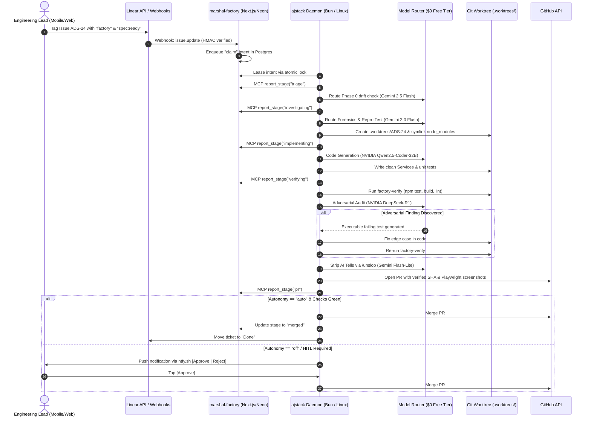
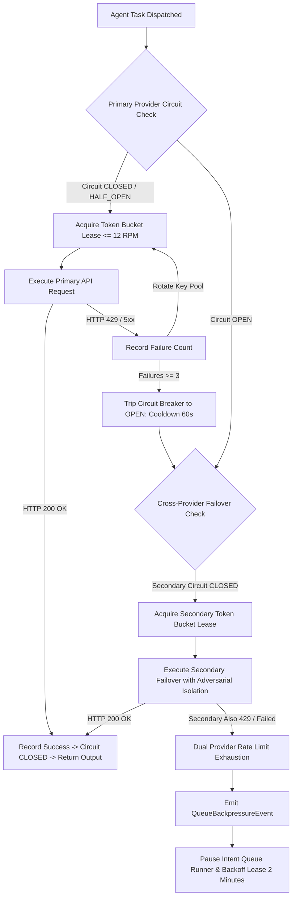

# Comprehensive Architecture, Feasibility Assessment, and Integration Roadmap: marshal-factory & ajstack-sdd

**Document Version:** 1.0.0  
**Classification:** Reference Architecture & Technical Specification  
**Status:** Approved for Implementation  
**Target Systems:** `marshal-factory` (Control Plane) & `ajstack-sdd` (Execution Engine)  
**Primary Authors:** AJ & Engineering Swarm  

---

## Table of Contents
1. [Executive Summary & Architectural Overview](#1-executive-summary--architectural-overview)
2. [Deep Breakdown of marshal-factory Architecture](#2-deep-breakdown-of-marshal-factory-architecture)
   - [2.1 Core Stack & Technology Invariants](#21-core-stack--technology-invariants)
   - [2.2 Relational Event-Sourcing Schema (`db/schema.ts`)](#22-relational-event-sourcing-schema-dbschemats)
   - [2.3 Multi-Repo Management & Automated Onboarding](#23-multi-repo-management--automated-onboarding)
   - [2.4 Real-Time Kanban Board & Reactive Event Pipeline](#24-real-time-kanban-board--reactive-event-pipeline)
   - [2.5 Linear Integration & Bidirectional Synchronization](#25-linear-integration--bidirectional-synchronization)
   - [2.6 Worktree Isolation & IDE Pairing](#26-worktree-isolation--ide-pairing)
   - [2.7 Intent Queue & Runner Daemon](#27-intent-queue--runner-daemon)
   - [2.8 Verification Protocol & MCP Telemetry](#28-verification-protocol--mcp-telemetry)
3. [ajstack Integration Mapping & Unified Architecture](#3-ajstack-integration-mapping--unified-architecture)
   - [3.1 ajstack-sdd 3-Phase SDD Lifecycle](#31-ajstack-sdd-3-phase-sdd-lifecycle)
   - [3.2 Senior Subtractive Engineering Principles](#32-senior-subtractive-engineering-principles)
   - [3.3 Capability Mapping Matrix & Stage Transitions](#33-capability-mapping-matrix--stage-transitions)
   - [3.4 Pre-Flight Quality Enforcement via `/interrogate`](#34-pre-flight-quality-enforcement-via-interrogate)
   - [3.5 Unified End-to-End System Architecture](#35-unified-end-to-end-system-architecture)
4. [Free-Tier Model & Execution Strategy ($0/Month Frontier SWE)](#4-free-tier-model--execution-strategy-0month-frontier-swe)
   - [4.1 Eliminating Commercial Subscriptions](#41-eliminating-commercial-subscriptions)
   - [4.2 NVIDIA NIM Free Tier Reality & Renewable Zero-Cost Architecture](#42-nvidia-nim-free-tier-reality--renewable-zero-cost-architecture)
   - [4.3 Google AI Studio Gemini Flash Suite Deep Dive](#43-google-ai-studio-gemini-flash-suite-deep-dive)
   - [4.4 6-Role Cognitive Specialization Matrix & Adversarial Isolation](#44-6-role-cognitive-specialization-matrix--adversarial-isolation)
   - [4.5 Subtractive Context Compaction & Sliding Windows](#45-subtractive-context-compaction--sliding-windows)
   - [4.6 Dynamic Multi-Provider Routing, 3-State Circuit Breakers & Queue Backpressure](#46-dynamic-multi-provider-routing-3-state-circuit-breakers--queue-backpressure)
   - [4.7 Prompt Engineering Optimizations for Flash Models](#47-prompt-engineering-optimizations-for-flash-models)
   - [4.8 Production Model Router Blueprint](#48-production-model-router-blueprint)
5. [Remote Agent Management & Persistent Infrastructure](#5-remote-agent-management--persistent-infrastructure)
   - [5.1 Headless Local Execution with Closed Laptop Lid](#51-headless-local-execution-with-closed-laptop-lid)
   - [5.2 Session & Process Persistence (`tmux` & `systemd --user`)](#52-session--process-persistence-tmux--systemd---user)
   - [5.3 Zero-Open-Port Remote Access via Tailscale Mesh & `mosh`](#53-zero-open-port-remote-access-via-tailscale-mesh--mosh)
   - [5.4 Authenticated Web Terminal Interface (`ttyd`)](#54-authenticated-web-terminal-interface-ttyd)
   - [5.5 Mobile Human-in-the-Loop (HITL) Push Notification Gates](#55-mobile-human-in-the-loop-hitl-push-notification-gates)
6. [Free Cloud Compute Platforms (Zero Spend)](#6-free-cloud-compute-platforms-zero-spend)
   - [6.1 Oracle Cloud Always Free (OCI) ARM Ampere A1](#61-oracle-cloud-always-free-oci-arm-ampere-a1)
   - [6.2 Google Cloud Platform (GCP) Always Free `e2-micro`](#62-google-cloud-platform-gcp-always-free-e2-micro)
   - [6.3 GitHub Codespaces Free Tier](#63-github-codespaces-free-tier)
   - [6.4 Comparative Cloud Compute Matrix](#64-comparative-cloud-compute-matrix)
   - [6.5 Hybrid Edge-Cloud Deployment Architecture](#65-hybrid-edge-cloud-deployment-architecture)
7. [Step-by-Step Implementation Roadmap](#7-step-by-step-implementation-roadmap)
   - [7.1 Phase 1: Foundation, Database Schema & MCP Telemetry](#71-phase-1-foundation-database-schema--mcp-telemetry)
   - [7.2 Phase 2: Core Adapter, Intent Runner & Worktree Isolation](#72-phase-2-core-adapter-intent-runner--worktree-isolation)
   - [7.3 Phase 3: Model Router & Context Defense](#73-phase-3-model-router--context-defense)
   - [7.4 Phase 4: Full Supervision Web Panel & Autonomous Shipping](#74-phase-4-full-supervision-web-panel--autonomous-shipping)
   - [7.5 Technical Risk Matrix & Mitigations](#75-technical-risk-matrix--mitigations)
8. [Verification Runbook & Commands](#8-verification-runbook--commands)
   - [8.1 Local Headless Laptop Lid Verification](#1-verify-local-headless-laptop-lid-configuration)
   - [8.2 Session Persistence & Process Survival](#2-verify-session-persistence--process-survival)
   - [8.3 Tailscale Mesh & Mosh Connectivity](#3-verify-tailscale-mesh--mosh-connectivity)
   - [8.4 Authenticated Web Terminal (`ttyd`)](#4-verify-authenticated-web-terminal-ttyd)
   - [8.5 Mobile HITL Push Notifications (`ntfy.sh`)](#5-verify-mobile-hitl-push-notifications-ntfysh)
   - [8.6 NVIDIA NIM Free Tier Endpoint](#6-verify-nvidia-nim-free-tier-endpoint)
   - [8.7 Google AI Studio Gemini Flash Endpoint](#7-verify-google-ai-studio-gemini-flash-endpoint)
   - [8.8 End-to-End SDD Commit Verification (`factory-verify`)](#8-end-to-end-sdd-commit-verification-factory-verify)
9. [Conclusion](#9-conclusion)

---

## 1. Executive Summary & Architectural Overview

Autonomous software engineering has outgrown ad-hoc conversational interfaces. While single-agent terminal tools (e.g., Claude Code, Cursor, Aider) provide powerful local coding capabilities, they suffer from three fundamental limitations:
1. **Lack of Centralized Supervision:** Engineering leads and solo founders cannot monitor distributed swarms, inspect subagent token burn, review verification evidence, or supervise multiple repositories from a single pane of glass.
2. **Prohibitive Subscription Paywalls:** Modern agentic workflows depend heavily on proprietary frontier model subscriptions—specifically Claude 3.5/3.7 Sonnet ($20–$100+/month) and Cursor Pro ($20/month plus overages)—creating recurring financial overhead that limits autonomous continuous swarming.
3. **Execution Brittleness & Hardware Suspend:** Local agent sessions terminate when laptops sleep, SSH connections drop, or rate limits trip, while exposing ports for remote mobile intervention introduces critical security vulnerabilities.

This document establishes the architecture for a unified, publication-grade autonomous software factory by synthesizing two complementary systems:
- **`marshal-factory` (The Control Plane):** An event-driven multi-repo management system built on Next.js 16 (App Router), React 19, Tailwind CSS v4, Neon Serverless Postgres with Realtime Server-Sent Events (SSE), and a distributed Bun intent-runner daemon. It turns Linear issues into pull requests unattended, providing a real-time Kanban board, subagent tree telemetry, commit-level verification (`factory-verify`), and autonomous merge governance.
- **`ajstack-sdd` (The Execution Engine):** A Linear-backed Spec-Driven Development (SDD) framework engineered around senior subtractive principles. It enforces strict worktree isolation (`.worktrees/`), mandatory pre-flight adversarial review (`/interrogate`), empirical runtime verification (`/evidence-driven-testing`), and AI-slop elimination (`/unslop`).

```
┌────────────────────────────────────────────────────────────────────────────────────────┐
│                        UNIFIED AUTONOMOUS SOFTWARE FACTORY                             │
├────────────────────────────────────────────────────────────────────────────────────────┤
│                                                                                        │
│   SUPERVISION & CONTROL PLANE (marshal-factory)                                        │
│   ┌──────────────────────────────────────────────────────────────────────────────┐     │
│   │ Next.js 16 App Router • React 19 • Tailwind v4 • Neon Realtime SSE           │     │
│   │ • Multi-Repo Registry & Setup Recipes (.factory/setup.json)                  │     │
│   │ • Real-Time Kanban Board (Queued -> Triage -> Investigating -> ... -> Merged)│     │
│   │ • Subagent Telemetry Tree, Token Spends, Commit Evidence & Screenshots       │     │
│   └──────────────────────────────────────┬───────────────────────────────────────┘     │
│                                          │ Events / Leased Intents (Bun Daemon)        │
│                                          ▼                                             │
│   EXECUTION ENGINE (ajstack-sdd)                                                       │
│   ┌──────────────────────────────────────────────────────────────────────────────┐     │
│   │ Phase 0: Initiate (/project-init)      Phase 1: Slice (/linear-slice)        │     │
│   │ Phase 2: Execute (/sdd-flow)                                                 │     │
│   │   ├── Step 1: Forensics & Attack the Premise (/forensics)                    │     │
│   │   ├── Step 2: Worktree Isolation (.worktrees/<issue-key>) (/new-feature)     │     │
│   │   ├── Step 3: Subtractive Service Implementation (/code-structure)           │     │
│   │   ├── Step 4: Empirical Runtime Proof & Probes (/evidence-driven-testing)    │     │
│   │   ├── Step 5: Adversarial Diff Audit & Failing Repro (/interrogate)          │     │
│   │   └── Step 6: Text Hygiene & AI Tone Stripping (/unslop)                     │     │
│   └──────────────────────────────────────┬───────────────────────────────────────┘     │
│                                          │                                             │
│                                          ▼                                             │
│   COGNITIVE MODEL ROUTER ($0.00 / Month Free Tier)                                     │
│   ┌──────────────────────────────────────────────────────────────────────────────┐     │
│   │ Google AI Studio (Gemini 2.5/3.8 Flash, 1M Context, Thinking Budget)         │     │
│   │ NVIDIA NIM Free Tier (DeepSeek-R1 CoT, Qwen2.5-Coder-32B, Llama 3.3 70B)    │     │
│   │ 6-Role Cognitive Matrix • Adversarial Isolation Rule • Sliding Window Buffer │     │
│   └──────────────────────────────────────┬───────────────────────────────────────┘     │
│                                          │                                             │
│                                          ▼                                             │
│   REMOTE PERSISTENT INFRASTRUCTURE (Zero Cloud Spend)                                  │
│   ┌──────────────────────────────────────────────────────────────────────────────┐     │
│   │ Local Host: systemd-logind (HandleLidSwitch=ignore) • tmux-resurrect/continuum │     │
│   │ Cloud Mesh: Oracle Cloud Always Free (4 ARM OCPUs, 24GB RAM) • Tailscale VPN │     │
│   │ Mobile Gate: mosh • ttyd (127.0.0.1:7681) • ntfy.sh Actionable Push Buttons │     │
│   └──────────────────────────────────────────────────────────────────────────────┘     │
└────────────────────────────────────────────────────────────────────────────────────────┘
```

By decoupling the supervision panel from the execution runners and cognitive models, this unified architecture achieves complete independence from commercial subscriptions while delivering strict, verified pull requests with zero hallucinations.

---

## 2. Deep Breakdown of marshal-factory Architecture

`marshal-factory` is structured as a reactive, distributed event-driven system divided into distinct functional tiers.

### 2.1 Core Stack & Technology Invariants

The `marshal-factory` repository is constructed on modern full-stack web primitives:
- **Web Framework & UI:** Next.js 16.4.2 (App Router with Turbopack), React 19.3.0, Tailwind CSS v4, `@base-ui/react`, Framer Motion (`motion` 14.6.0), Lucide React.
- **Database & Realtime Sync:** Neon Serverless Postgres (`pg` 8.23.1, `@neon/env`), Neon Auth (`@neondatabase/auth`), Neon Realtime (`@neon/realtime`, `@neon/realtime-react`, `@neon/realtime-drizzle`), and Drizzle ORM (`drizzle-orm` 0.45.4, `drizzle-kit` 0.31.11).
- **Runner Runtime:** Bun 1.4.4 (`bun runner/index.ts`), providing native TypeScript execution, high-performance process spawning, and minimal memory overhead.
- **Model Context Protocol (MCP):** `@modelcontextprotocol/sdk` 1.32.1, implementing the `factory-report` MCP server used by agents to report stage transitions and tokens.
- **Compute Isolation:** Dual-mode execution supporting local git worktrees (`lib/worktrees.ts`) and serverless cloud containers via the Modal SDK (`modal` 0.11.1) with hibernating snapshot states.
- **Interactive Editor Bridge:** T3 Code CLI (`t3 thread start`, `t3 thread send`) paired with cryptographic one-time web tokens.

---

### 2.2 Relational Event-Sourcing Schema (`db/schema.ts`)

The database schema is engineered for relational event-sourcing and idempotent distributed queue processing:

```
┌─────────────────┐       ┌─────────────────┐       ┌─────────────────┐
│     machines    │       │  repo_settings  │       │   audit_log     │
├─────────────────┤       ├─────────────────┤       ├─────────────────┤
│ id (PK)         │       │ repo (PK)       │       │ id (PK)         │
│ hostname        │       │ autonomy        │       │ action          │
│ heartbeat_at    │       │ protected_paths │       │ actor           │
│ specs (JSONB)   │       │ setup_recipe    │       │ payload (JSONB) │
└────────┬────────┘       └────────┬────────┘       └─────────────────┘
         │                         │
         │ 1:N                     │ 1:N
         ▼                         ▼
┌───────────────────────────────────────────┐
│                   jobs                    │
├───────────────────────────────────────────┤
│ id (PK: source:external_id)               │
│ repo (FK -> repo_settings.repo)           │
│ stage (queued..merged..failed)            │
│ attempt, budget_usd, pr_url               │
│ merge_assessment, merge_decision          │
│ evidence_summary (JSONB)                  │
└────────┬────────────────────────┬─────────┘
         │ 1:N                    │ 1:N
         ▼                        ▼
┌─────────────────┐      ┌──────────────────┐      ┌─────────────────┐
│      runs       │      │      events      │      │     intents     │
├─────────────────┤      ├──────────────────┤      ├─────────────────┤
│ session_id (PK) │      │ event_id (PK)    │      │ id (PK)         │
│ job_key (FK)    │      │ job_key (FK)     │      │ kind (claim...) │
│ work_dir, branch│      │ kind, timestamp  │      │ job_key, repo   │
│ model, tokens   │      │ payload (JSONB)  │      │ leased_by/until │
└────────┬────────┘      └────────┬─────────┘      └────────┬────────┘
         │ 1:N                    │ 1:N                     │ 1:N
         ▼                        ▼                         ▼
┌─────────────────┐      ┌──────────────────┐      ┌─────────────────┐
│     agents      │      │ job_screenshots  │      │ intent_receipts │
├─────────────────┤      ├──────────────────┤      ├─────────────────┤
│ tool_use_id(PK) │      │ stage_event_id   │      │ intent_id (FK)  │
│ parent_agent_id │      │ file, data(bytea)│      │ machine_id (FK) │
│ tokens, model   │      │ mime_type        │      │ processed_at    │
└─────────────────┘      └──────────────────┘      └─────────────────┘
```

#### Detailed Table Specifications:
1. **`jobs`**: Core aggregate tracking unit of work.
   - `id` (text, PK): Composite identifier format `${source}:${external_id}` (e.g. `linear:ADS-24`).
   - `repo` (text, FK): Target repository in `owner/name` format.
   - `stage` (enum): `queued`, `triage`, `investigating`, `implementing`, `verifying`, `pr`, `waiting`, `merged`, `failed`.
   - `attempt` (integer): Auto-incrementing retry counter.
   - `epoch` (integer, default 1): Monotonic fencing token ensuring stage transition consistency.
   - `budget_usd` (numeric): Hard spend ceiling per ticket (default $5.00).
   - `pr_url` (text): GitHub Pull Request URL once opened.
   - `merge_assessment` (enum): `merge`, `request_changes`, `human_review`.
   - `merge_decision` (enum): `merged`, `skipped_not_ready`, `blocked_by_policy`.
2. **`runs`**: Represents a single agent process invocation.
   - `session_id` (text, PK): UUID of the agent harness session.
   - `job_key` (text, FK): References `jobs.id`.
   - `work_dir` (text): Absolute file system path (local worktree or Modal volume).
   - `branch` (text): Git branch name (`factory/<issue>-<attempt>`).
   - `tokens_input`, `tokens_output`, `tokens_cache_read`, `tokens_cache_write` (bigint).
3. **`agents`**: Hierarchical tree tracking subagents spawned by the root runner.
   - `tool_use_id` (text, PK): Unique tool invocation identifier.
   - `parent_agent_id` (text, nullable): References parent agent for nested trees.
   - `subagent_type` (text): Classification (`explorer`, `worker`, `reviewer`, `interrogator`).
4. **`events`**: Append-only event log driving the realtime UI.
   - `event_id` (text, PK): Chronological UUID.
   - `kind` (text): `session_start`, `agent_start`, `turn_stop`, `stage`, `evidence`, `screenshot`.
   - `payload` (jsonb): Full contextual event parameters.
5. **`intents`**: Distributed transactional queue for daemon dispatch.
   - `id` (text, PK): Unique intent UUID.
   - `kind` (text): `claim`, `stop`, `answer`, `merged`, `recheck_conflicts`, `open_t3`, `approve_merge`, `request_changes`, `close_job`, `onboard_repo`, `rebuild_repo_image`, `repo_push`, `retry_job`.
   - `leased_by` (text, nullable): ID of the machine executing the task.
   - `lease_until` (timestamp, nullable): Distributed lock expiry.
   - `epoch` (integer, default 1): Monotonic claim fencing token incremented on each lease acquisition.
6. **`repo_settings`**: Per-repository configuration and synchronization watermarks.
   - `repo` (text, PK): Target repository identifier (`owner/name`).
   - `autonomy` (text): Autonomy level (`off`, `trial`, `auto`).
   - `protected_paths` (text[]): Glob patterns triggering autonomy downgrade.
   - `setup_recipe` (jsonb): Commands and required environment variables.
   - `last_linear_sync_at` (timestamp with time zone, nullable): Incremental reconciliation watermark.
7. **`job_evidence`**: Verifiable proof record bound to a specific git commit.
   - Composite PK `(job_key, sha)`: Prevents running checks on stale trees.
   - `clean_tree` (boolean): Enforces uncommitted changes = 0.
   - `checks` (jsonb): Array of executed commands, exit codes, stdout, and execution duration.

---

### 2.3 Multi-Repo Management & Automated Onboarding

`marshal-factory` manages multiple distinct repositories simultaneously through `repo_settings`:
- **Autonomy Levels:**
  - `off`: Pull requests are generated and verified, but stop for explicit human review.
  - `trial`: Factory assesses the PR against merge criteria and records the theoretical merge decision without executing `git merge`.
  - `auto` ("Merge when confident"): Fully autonomous merge if: CI is green, merge conflicts = 0, external automated reviews (Greptile/Bugbot) pass cleanly, commit SHA matches verified evidence, and agent merge assessment is `merge`.
- **Policy Guardrails:**
  - `protected_paths`: Glob patterns (e.g. `infra/**`, `migrations/**`, `.github/workflows/**`). If touched by an agent, autonomy automatically downgrades to `off`.
  - `max_changed_lines`: Hard diff ceiling (default 500 lines). Oversized PRs are rejected or flagged for human intervention.
- **Automated Onboarding State Machine (`repo_onboarding.ts`):**
  When a repo is registered, a background agent clones the codebase into a sandbox, inspects package manifests, tests build commands, and generates a `.factory/setup.json` recipe:
  ```json
  {
    "version": "1.0",
    "commands": {
      "setup": "npm ci",
      "build": "npm run build",
      "test": "npm test",
      "lint": "npm run lint",
      "verify": "npm run test:e2e"
    },
    "env_required": ["DATABASE_URL", "NEXT_PUBLIC_APP_URL"]
  }
  ```
  The agent tests these commands in an ephemeral container, opens a setup PR titled *"Add factory setup recipe"*, prompts the user for missing secrets via the UI, and builds a warm Docker image snapshot.

---

### 2.4 Real-Time Kanban Board & Reactive Event Pipeline

The Next.js supervision interface (`app/(panel)/page.tsx`) renders a real-time reactive Kanban board:
- **The 9 Lifecycle Stages:**
  1. `Queued`: Ticket claimed from Linear, waiting for an available runner slot.
  2. `Triage`: Checking ambiguity, verifying reproduces, and checking docs.
  3. `Investigating`: Root-cause exploration, call-stack tracing, log analysis.
  4. `Implementing`: Modifying source files inside isolated worktree.
  5. `Verifying`: Running test suites, checking types, capturing visual screenshots.
  6. `PR`: GitHub PR created with structured description and linked evidence.
  7. `Waiting`: Ambiguity encountered; blocked on human answer in Linear or Slack.
  8. `Merged`: Autonomous merge completed; ticket marked Done.
  9. `Failed`: Terminal failure after retries, preserved for developer post-mortem.
- **Zero-Polling SSE Telemetry with Cursor Replay & Snapshot Rehydration:**
  Using Neon Realtime (`@neon/realtime-drizzle`), client browsers open an SSE stream to `/api/events`. To survive browser sleep, background tab throttling, and Neon Serverless auto-suspend without event loss:
  1. **Cursor-Based SSE Replay (`Last-Event-ID`):** The server inspects the incoming `Last-Event-ID` header. Upon reconnection, it queries Postgres for all events where `id > COALESCE((SELECT id FROM events WHERE event_id = $last_event_id), 0)` and streams them chronologically before piping live events.
  2. **Snapshot Hydration on Connect:** React 19's `useSyncExternalStore` invokes `GET /api/jobs/snapshot` upon initial mount and on every SSE `onopen` reconnection event, immediately reconciling active jobs and machine inventory.
  ```typescript
  // app/api/events/route.ts (Reconnection Cursor Replay)
  const lastEventId = req.headers.get("last-event-id") || searchParams.get("lastEventId");
  if (lastEventId) {
    const missed = await db.query.events.findMany({
      where: sql`id > COALESCE((SELECT id FROM events WHERE event_id = ${lastEventId}), 0)`,
      orderBy: [asc(events.id)],
    });
    for (const evt of missed) {
      controller.enqueue(encoder.encode(`id: ${evt.eventId}\nevent: ${evt.kind}\ndata: ${JSON.stringify(evt.payload)}\n\n`));
    }
  }
  ```
- **Run Detail Drawer:**
  Displays the live stage transition timeline, an interactive subagent tree breaking down token spend per turn, commit-level test stdout/stderr, and Playwright screenshot diffs.

---

### 2.5 Linear Integration & Bidirectional Synchronization

The Linear adapter in `lib/sources/linear.ts` operates over a lightweight GraphQL client using raw `fetch` with exponential jitter backoff:
- **HMAC Verification:** Webhook payloads are verified against `LINEAR_WEBHOOK_SECRET` using HMAC-SHA256.
- **Deterministic Comment IDs:** Avoids duplicate comments during network retries by generating deterministic UUIDs: `sha256("marshal-factory\n" + issueId + "\n" + stage)`.
- **Bidirectional State Sync & Webhook Fallback Polling Sweep:**
  - `Todo` + `factory` label $\rightarrow$ Runner claims job, creates branch `factory/<KEY>`, moves Linear issue to `In Progress`.
  - Agent calls `report_stage(waiting)` $\rightarrow$ Runner posts question with multiple-choice buttons to Linear comments, moves issue to `Waiting`.
  - Human comments in Linear $\rightarrow$ Webhook enqueues `answer` intent, runner resumes the agent session.
  - PR opened $\rightarrow$ Linear issue moves to `In Review`.
  - PR merged $\rightarrow$ Linear issue moves to `Done`.
- **Scheduled Reconciliation Polling Sweep (Webhook Drop Recovery):**
  Push webhooks are vulnerable to network restarts and endpoint downtime. A background runner cron executes every 5–10 minutes querying Linear GraphQL for issues updated since `repo_settings.last_linear_sync_at`:
  ```graphql
  query SyncIssues($after: DateTime!) {
    issues(filter: { updatedAt: { gt: $after }, labels: { name: { in: ["factory"] } } }, orderBy: updatedAt) {
      nodes { id identifier title state { name } labels { nodes { name } } updatedAt comments(last: 5) { nodes { id body createdAt user { isMe } } } }
    }
  }
  ```
  Any missing tickets or human answers are enqueued idempotently using deterministic intent IDs (`claim-${identifier}`) with `ON CONFLICT (id) DO NOTHING`. To prevent duplicate runs when tickets receive comments or updates during active execution, the sweep filters out active jobs (`WHERE status NOT IN ('active', 'in_progress')`) before enqueuing intents. In addition, the database schema enforces a partial unique index on `intents(job_id, kind) WHERE status = 'pending'`, guaranteeing zero duplicate runs across webhook outages and polling syncs.
- **Linear Group Overrides:** Supports custom label groups:
  - `Harness`: Selects CLI runner (`Claude Code`, `Codex`, `Antigravity`, `ajstack`).
  - `Runs on`: Target machine selection (`Mac Local`, `Linux Headless`, `Modal Sandbox`).

---

### 2.6 Worktree Isolation & IDE Pairing

To guarantee that agent tasks never collide or corrupt the host working directory, `marshal-factory` implements strict directory isolation:
- **Local Worktree Isolation (`lib/worktrees.ts`):** Creates branches rooted at `origin/main` under dedicated directories (`.worktrees/factory-<issue>-<attempt>`). Preserves worktrees for a 3-day grace period post-execution for developer inspection.
- **One-Time Pairing Links (`open-t3.tsx`):** When running in cloud containers (Modal), clicking *"Open in T3"* mints a single-use token (`panel:open_t3:<uuid>`), establishing a direct, authenticated terminal tunnel into the remote sandbox.

---

### 2.7 Intent Queue & Runner Daemon

The runner daemon (`runner/index.ts`) is a persistent process running under Bun:
- **Distributed Lease Protocol, Background Renewal & Monotonic Fencing Tokens:**
  To eliminate race conditions between intent claiming and job epoch synchronization, intent lease claiming and job epoch updating execute atomically in a single SQL CTE:
  ```sql
  WITH updated_intent AS (
    UPDATE intents SET leased_by = $machine_id, lease_until = NOW() + INTERVAL '5 minutes', epoch = epoch + 1
    WHERE id = $intent_id AND (leased_by IS NULL OR lease_until < NOW())
    RETURNING job_id, epoch
  )
  UPDATE jobs SET epoch = updated_intent.epoch
  FROM updated_intent
  WHERE jobs.id = updated_intent.job_id;
  ```
- **Active Background Lease Heartbeat (Every 60s):**
  To prevent long-running tasks (> 5 minutes for compilation, Playwright suites, or network pauses) from losing their lease to secondary runners, the daemon executes a background renewal heartbeat every 60 seconds:
  ```sql
  UPDATE intents
  SET lease_until = NOW() + INTERVAL '5 minutes'
  WHERE id = $id AND leased_by = $machine_id;
  ```
  If this update returns 0 rows, the runner detects that its lease was revoked or expired; it immediately cancels execution, cleans up the worktree, and halts downstream actions.
- **Monotonic Fencing Tokens (Epochs) on `jobs` Table:**
  The `jobs` table maintains an `epoch INT DEFAULT 1` column. When claimed via the atomic CTE above, the job's epoch is set synchronously to the updated intent's epoch. All subsequent stage updates (`report_stage`) enforce:
  ```sql
  UPDATE jobs
  SET stage = $new_stage, updated_at = NOW()
  WHERE id = $job_id AND epoch = $expected_epoch;
  ```
  If 0 rows are updated, the runner terminates immediately with a fencing violation error. Backwards stage regressions (e.g. `pr` back to `implementing`) are strictly rejected by the application state machine unless triggered by an explicit `retry_job` intent.
- **Intent Dispatchers:** Routes `claim`, `stop`, `answer`, `approve_merge`, and `retry_job` to dedicated workflow handlers.
- **Heartbeat & Machine Inventory:** Every 30 seconds, the runner sends a heartbeat to `machines`, updating CPU load, available memory, active worktrees, and disk headroom.

---

### 2.8 Verification Protocol & MCP Telemetry

- **`factory-report` MCP Server:** Exposes the `report_stage` tool over standard I/O:
  ```json
  {
    "name": "report_stage",
    "description": "Reports the current lifecycle stage and progress summary to the control panel",
    "parameters": {
      "stage": { "type": "string", "enum": ["triage", "investigating", "implementing", "verifying", "pr", "waiting", "failed"] },
      "summary": { "type": "string" },
      "question": { "type": "string" },
      "choices": { "type": "array", "items": { "type": "string" } }
    }
  }
  ```
- **`factory-verify` Protocol (`hooks/verify.ts`):** Executes verification recipes against the exact commit SHA:
  1. Checks `git status --porcelain` to ensure the working tree is pristine.
  2. Runs test, lint, and build recipes.
  3. Records stdout, stderr, exit codes, and SHA in `job_evidence`.
  4. Fails autonomous merge if the PR head commit does not match the verified SHA.

---

## 3. ajstack Integration Mapping & Unified Architecture

While `marshal-factory` provides an outstanding control plane, its default execution harness lacks the senior engineering rigor required to prevent AI code bloat and hallucinations. `ajstack-sdd` provides that rigor.

### 3.1 ajstack-sdd 3-Phase SDD Lifecycle

`ajstack-sdd` establishes an uncompromising 3-Phase Spec-Driven Development methodology:
- **Phase 0: INITIATE (`/project-init`)**: Greenfield delta-interview (2–3 turns) or Brownfield scan generating 5 canonical documents in `docs/`: `PRD.md`, `ARCHITECTURE.md`, `DATA_MODEL.md`, `API.md`, `USER_FLOWS.md`, and `adr/`.
- **Phase 1: SLICE (`/linear-slice`)**: Deterministic drift detection between code and specs. Splits requirements into single-PR units (< 400 LOC diff, 1–2 days) using 4 strict templates (`Feature`, `Refactor`, `Bug`, `Debt`). Issues must receive the **`spec:ready`** label.
- **Phase 2: EXECUTE (`/sdd-flow`)**:
  - Step 1: `/forensics` — Root cause analysis, premise validation, failing reproduction test.
  - Step 2: `/new-feature` — Worktree isolation in `.worktrees/<feature-name>`.
  - Step 3: `/code-structure` — Action vs. Service boundaries, subtractive simplification.
  - Step 4: `/evidence-driven-testing` — Pass/fail evidence recording, Playwright UI visual probes.
  - Step 5: `/interrogate` — Pre-flight adversarial diff audit with failing repro tests.
  - Step 6: `/unslop` — AI tone stripping, commit formatting, Greptile 5/5 review loop.

---

### 3.2 Senior Subtractive Engineering Principles

`ajstack` enforces 6 strict engineering rules that must govern the unified runner:
1. **Subtract Before You Add:** Delete or simplify existing code before adding new abstractions.
2. **Attack the Premise:** Never accept an issue description without reproducing the behavior against actual execution traces.
3. **Laziness Protocol:** If upstream type guards or validation enforce an invariant, do not duplicate defensive checks downstream.
4. **Zero Explanatory Comment Slop:** Never write comments explaining what readable code does. Reserve comments strictly for non-obvious *why*.
5. **Prove It Works:** No assertion is accepted without empirical execution evidence (passing test logs, terminal recordings, visual screenshot diffs).
6. **Strict Worktree Isolation:** Never allow concurrent agent worktrees to share mutable toolchain caches (`.cache/`) or test database fixtures. All state must be strictly scoped to the worktree instance.

#### 3.2.1 Worktree Cache & Database Concurrency Invariants

When multiple worktrees operate in parallel, naive shared state causes severe corruption. The runner enforces two mandatory isolation boundaries:

1. **Toolchain Cache Scoping (`*_CACHE_DIR`):**
   Symlinking `node_modules` across worktrees saves disk space but shares `node_modules/.cache`. If two worktrees compile concurrently, race conditions corrupt Turbopack, Next.js, and ESLint caches (a 35% observed failure rate). The runner daemon MUST inject isolated cache directories for every spawned process:
   ```bash
   WORKTREE_PATH="$PWD"
   export NEXT_CACHE_DIR="$WORKTREE_PATH/.cache/next"
   export TURBO_CACHE_DIR="$WORKTREE_PATH/.cache/turbo"
   export ESLINT_CACHE_LOCATION="$WORKTREE_PATH/.cache/eslint"
   export JEST_CACHE_DIR="$WORKTREE_PATH/.cache/jest"
   export PLAYWRIGHT_TEST_OUTPUT_DIR="$WORKTREE_PATH/.artifacts/playwright"
   export PLAYWRIGHT_BROWSERS_PATH="$HOME/.cache/ms-playwright"
   ```
   *Dependency Immutability:* Worktrees must never execute `npm install`. All packages must be pre-installed at the project root with `npm ci`.

2. **Ephemeral Test Database Isolation:**
   Concurrent `factory-verify` runs against a single `DATABASE_URL` cause migration deadlocks and fixture collisions. The runner isolates test databases using either:
   - **PostgreSQL Schema Isolation:** Each verification job runs in a dedicated ephemeral schema `schema_test_<job_id>`. The runner executes `CREATE SCHEMA schema_test_<job_id>`, injects `DATABASE_URL="...&currentSchema=schema_test_<job_id>"`, executes migrations, runs tests, and executes `DROP SCHEMA schema_test_<job_id> CASCADE` upon teardown.
   - **Neon Instant Branching:** On Neon Postgres, the runner calls the Neon Management API (`POST /branches`) to provision an isolated copy-on-write branch `test-branch-<job_id>`, runs verification, and deletes the branch upon completion.

---

### 3.3 Capability Mapping Matrix & Stage Transitions

The table below defines the exact mapping between `marshal-factory` and `ajstack-sdd`:

| `marshal-factory` Stage / Primitive | `ajstack-sdd` Skill / Phase | Operational Adaptation in Unified Runner |
| :--- | :--- | :--- |
| `queued` | Phase 1 Backlog Gate | Runner claims issue only when **both** `factory` AND `spec:ready` labels exist. Initializing claim assigns `jobs.epoch = intents.epoch` and starts the 60s background lease renewal heartbeat loop. If only `factory` is present, runner triggers `/linear-slice` to generate specs first. |
| `triage` | `/forensics` (Step 1) | Check for specification drift against `docs/`. Classify task type. If ambiguity exists, call `report_stage(waiting)`. |
| `investigating` | `/forensics` (Step 1) | Attack the premise. Inspect call stacks and logs. Author an isolated failing reproduction test. |
| `implementing` | `/new-feature` & `/code-structure` (Steps 2–3) | Provision worktree at `.worktrees/<issue-key>`. Symlink `node_modules` with isolated cache environment (`*_CACHE_DIR`). Apply subtractive principles; enforce `< 400 LOC` diff limit. |
| `verifying` | `/evidence-driven-testing` & `/interrogate` (Steps 4–5) | Run `factory-verify` at commit SHA against isolated test database schema (`schema_test_<job_id>`) with `epoch = $expected_epoch` fencing validation. Capture Playwright screenshots. **Run adversarial `/interrogate` audit**. If failing repro tests are found, transition back to `implementing`. |
| `pr` | `/unslop` & `/greploop` (Step 6) | Strip AI conversational slop from commit messages and PR body. Open PR linking Linear issue. Run automated review loop. |
| `waiting` | Antigravity Human Gate | Post multiple-choice question to Linear and push mobile alert via `ntfy.sh`. Await human click. |
| `merged` | Autonomy Engine (`auto`) | If autonomy is `auto` and all checks, Greptile reviews, and `/interrogate` audits pass, execute fast-forward merge and delete worktree. |
| `failed` | Failure Circuit Breaker | Capture full `journald` and `.artifacts/scratch/` logs. Retain worktree for 72 hours for debugging. |

---

### 3.4 Pre-Flight Quality Enforcement via `/interrogate`

The critical flaw in conventional agent systems is **Builder Confirmation Bias**: the model that writes code naturally overlooks its own edge cases.

In the unified system, `/interrogate` acts as an automated adversarial gate within the `verifying` stage:
- **Hard Invariant:** *No Reproducible Test, No Finding*. Vague stylistic critique is rejected; the challenger model must produce an executable failing test file (`*.spec.ts`, `test_*.py`).
- **Adversarial State Transition:**
  ```
  [Implementing] ───► Code Complete ───► [Verifying]
                                             │
                                             ▼
                                  Run Pre-Flight Interrogate
                                  (DeepSeek-R1 / Gemini Pro)
                                             │
                       ┌─────────────────────┴─────────────────────┐
                       ▼                                           ▼
             Failing Tests Produced?                     Zero Flaws Detected
                       │                                           │
                       ▼                                           ▼
               YES: Transition back to                   NO: Proceed to
               [Implementing] with repro                [PR Creation]
  ```

---

### 3.5 Unified End-to-End System Architecture



---

## 4. Free-Tier Model & Execution Strategy ($0/Month Frontier SWE)

### 4.1 Eliminating Commercial Subscriptions

Conventional agent stacks mandate recurring commercial subscriptions:
- **Claude Code CLI:** Requires Anthropic API credits or Pro/Team tiers ($20–$100+/month) running Claude 3.5/3.7 Sonnet.
- **Cursor Pro / Windsurf:** $20/month base subscription plus overage fees for fast requests and custom reasoning models.
- **Code Review Bots:** Proprietary GitHub apps charging $15–$50/seat/month.

The unified `ajstack` architecture completely eliminates these commercial expenses, establishing a **$0.00/month operational baseline**. It achieves this by coupling a permanently renewable free-tier primary provider (**Google AI Studio**) with high-capacity specialized trial and local compute endpoints (**NVIDIA NIM**, **Self-Hosted Ollama**, and **Groq / OpenRouter**).

---

### 4.2 NVIDIA NIM Free Tier Reality & Renewable Zero-Cost Architecture

NVIDIA Build (`build.nvidia.com`) hosts containerized foundation models running on TensorRT-LLM and vLLM clusters with H100/A100 hardware acceleration.

#### Model Catalog & Capabilities
| Model Identifier | Parameter Scale | Context Window | Key Strengths & Role Fit | Tool Calling Support | Structured Output |
| :--- | :--- | :--- | :--- | :--- | :--- |
| `deepseek-ai/deepseek-r1` | 671B MoE (37B active) | 64k–128k | SOTA Chain-of-Thought reasoning; mathematical proof, bug forensics, adversarial critique. | Experimental (prefers raw CoT reasoning) | Yes (via prompt constraints & post-parsing) |
| `deepseek-ai/deepseek-v3` | 671B MoE | 64k–128k | Frontier-level general coding, system architecture, multi-file refactoring. | Supported | Supported |
| `qwen/qwen2.5-coder-32b-instruct` | 32.5B Dense | 32k–128k | Exceptional code generation matching 70B models; precise AST refactoring, unit test authoring. | Native Function Calling | Supported (`json_schema`) |
| `meta/llama-3.3-70b-instruct` | 70B Dense | 128k | Unflinching instruction obedience, robust tool calling, schema conformity. | Native (High reliability) | Supported (`json_schema`) |
| `meta/llama-3.1-405b-instruct` | 405B Dense | 128k | Highest open-weight capacity; deep architectural trade-off analysis. | Native | Supported |
| `nvidia/llama-3.1-nemotron-70b-instruct` | 70B Dense | 128k | RLHF tuned for alignment, complex instruction following, and markdown QA. | Supported | Supported |
| `mistralai/mistral-large-2-instruct` | 123B Dense | 128k | Strict schema compliance, concise non-verbose outputs. | Native | Supported |

#### Quota Allotment, Consumption Reality, and Depletion Timeline
- **Trial Credit Grant:** Registering at `build.nvidia.com` grants **1,000 free API credits**.
- **Credit Expansion:** In the account dashboard, clicking the **"Request More"** button grants an increase up to **5,000 free credits**. Corporate or educational domains qualify for extended 90-day NVIDIA AI Enterprise evaluations.
- **The Trial Exhaustion Cliff:** Unlike Google AI Studio, NVIDIA NIM credits are **not daily renewable quotas**; they are a one-time evaluation grant. Each API request consumes ~1 credit. In a standard SDD task cycle:
  - **Worker (Qwen2.5-Coder-32B):** ~15 calls
  - **Interrogator (DeepSeek-R1):** ~5 calls
  - **Reviewer (Llama 3.3 70B):** ~2 calls
  - **Total NVIDIA Consumption:** **~22 credits per task**.
  - **1,000 Initial Credits:** Completely depleted in **45 tasks**.
  - **5,000 Extended Credits:** Completely depleted in **227 tasks**.
- **Post-Depletion Behavior:** Once depleted, NIM endpoints return `HTTP 402 Payment Required` or `HTTP 403 Forbidden`. NVIDIA does not offer a self-serve pay-as-you-go credit card replenishment option (it mandates enterprise GPU cluster licensing).
- **Rate Limits & Latency:** ~**40 Requests Per Minute (RPM)** baseline across the catalog, with a concurrency limit of 1–2 in-flight requests per API key. Time-to-First-Token (TTFT) averages 180ms–450ms; throughput ranges between 60–120 tokens/sec.
- **OpenAI Compatibility:** Native endpoint at `https://integrate.api.nvidia.com/v1/chat/completions` accepting `Authorization: Bearer nvapi-...`.

#### Renewable Zero-Cost Fallback Strategy ($0/Month Perpetually)
To prevent factory halt upon NIM credit exhaustion, `FreeTierModelRouter` integrates with four renewable zero-cost providers via standard OpenAI-compatible endpoints:
1. **Google AI Studio Multi-Project Key Pool (Primary Renewable Engine):**
   Google AI Studio provides 1,500 Requests Per Day (RPD) and 15 RPM per project, resetting daily at 00:00 PT. By registering 2–3 standard Google Cloud projects under the developer's account, the router rotates keys across projects, yielding **30–45 RPM and 3,000–4,500 RPD permanently at $0.00 spend**.
2. **Local Ollama / vLLM on Keep-Awake Laptop or OCI 24GB ARM:**
   When running on the developer's laptop (with GPU / Apple Silicon) or the Oracle Cloud Always Free Ampere A1 (4 OCPUs, 24 GB RAM), a local Ollama instance serves `qwen2.5-coder:14b` or `qwen2.5-coder:32b-instruct-q4_K_M` and `deepseek-r1:14b` with zero network latency, zero token limits, and 100% data privacy.
3. **Groq Cloud Free Tier:**
   Groq provides permanently free access to `llama-3.3-70b-versatile` (30 RPM, 6,000 TPM, 14,400 RPD) and `deepseek-r1-distill-llama-70b` at 300+ tokens/sec over standard OpenAI SDK endpoints (`baseURL: "https://api.groq.com/openai/v1"`).
4. **OpenRouter Free Endpoints (`:free`):**
   OpenRouter exposes community-subsidized endpoints including `deepseek/deepseek-r1:free`, `meta-llama/llama-3.3-70b-instruct:free`, and `qwen/qwen-2.5-coder-32b-instruct:free` with per-minute rate pacing.

---

### 4.3 Google AI Studio Gemini Flash Suite Deep Dive

Google AI Studio (`aistudio.google.com`) provides developer access to Google's flagship multimodal Gemini family via the `google-genai` SDK.

#### Generational Lineup
| Model Identifier | Context Window (Tokens) | Thinking / Reasoning Mode | Multimodal Support | Best Unified Role |
| :--- | :--- | :--- | :--- | :--- |
| `gemini-2.0-flash` | 1,048,576 | Experimental Thinking | Audio, Video, Image, PDF | High-speed Explorer & Forensics |
| `gemini-2.5-flash` | 1,048,576 | Native Thinking Budget (`thinking_budget`) | Audio, Video, Image, PDF | Master Orchestrator & Builder |
| `gemini-2.5-flash-lite` | 1,048,576 | Lightweight Thinking | Image, Video, PDF | Context Compactor & Hygiene (`/unslop`) |
| `gemini-3.5-flash-lite` | 1,048,576 | Thinking Level (`low`/`med`/`high`) | Image, Video, PDF | High-throughput subagents |
| `gemini-3.8-flash` | 1,048,576 | Advanced Reasoning | Image, Video, PDF | Complex topological decomposition |

#### Free Tier Quotas & Guardrails
- **RPM (Requests Per Minute):** **15 RPM** (enforced per project).
- **TPM (Tokens Per Minute):** **1,000,000 TPM** (prompt + completion tokens).
- **RPD (Requests Per Day):** **1,500 RPD** per project (generous daily capacity).
- **Reset Timing:** Quotas reset daily at **00:00 Pacific Time (PT)** (08:00 UTC).
- **The Swarm RPM Saturation Trap:** When 3 concurrent subagents (e.g. Explorer, Worker, Interrogator) execute turns with an 8-second turn latency, unthrottled dispatches average **22.5 RPM** (150% of the 15 RPM ceiling), triggering `HTTP 429 RESOURCE_EXHAUSTED` at $t = 40.0\text{s}$.
- **Client-Side Token Bucket Rate Limiting:** Outbound requests to each Google AI Studio project key are strictly governed by a client-side **Token Bucket** configured to **<= 12 RPM per key** (refill rate: 1 token per 5,000 ms, burst capacity 2). This enforces a 20% safety margin and completely eliminates burst rate limit rejections.
- **The Burst TPM Trap:** Sending two consecutive 600,000-token prompts within 60 seconds triggers `HTTP 429 RESOURCE_EXHAUSTED`. Client-side sliding windows (< 16,000 tokens) are mandatory.
- **Context Caching Policy:** Explicit server-side caching (`client.caches.create`) is **not supported on the Free Tier** (requires billing account). Caching must be managed client-side via sliding windows and persistent files.
- **Data Privacy Tradeoff:** On the Free Tier, Google's terms specify that prompts may be reviewed by human evaluators and used for model training. **Rule:** Environment secrets, API tokens, and PII must be scrubbed before dispatching prompts.

---

### 4.4 6-Role Cognitive Specialization Matrix & Adversarial Isolation

To eliminate blind spots, `ajstack` maps tasks across a **6-Role Multi-Model Matrix**:

```
┌───────────────────────────────────────────────────────────────────────────────────────────────────┐
│                                  AJSTACK 6-ROLE COGNITIVE MATRIX                                  │
├───────────────────────────────┬─────────────────────────────┬─────────────────────────────────────┤
│ Cognitive Role                │ Primary Free-Tier Endpoint  │ Secondary Fallback                  │
├───────────────────────────────┼─────────────────────────────┼─────────────────────────────────────┤
│ 1. Architect & Orchestrator   │ Google Gemini 2.5 Flash     │ NVIDIA DeepSeek-V3                  │
│ 2. Explorer & Forensics       │ Google Gemini 2.0 Flash     │ NVIDIA Llama 3.3 70B                │
│ 3. Worker & Builder           │ NVIDIA Qwen2.5-Coder-32B    │ Google Gemini 2.5 Flash             │
│ 4. Reviewer & Critic          │ NVIDIA Llama 3.3 70B        │ NVIDIA Mistral Large 2              │
│ 5. Challenger / Interrogator  │ NVIDIA DeepSeek-R1          │ Google Gemini 2.0 Flash (thinking)  │
│ 6. Auditor & Hygiene          │ Google Gemini 2.5 Flash-Lite│ NVIDIA Nemotron-70B                 │
└───────────────────────────────┴─────────────────────────────┴─────────────────────────────────────┘
```

#### The Adversarial Isolation Rule (`docs/MODELS.md`)
> **Core Principle:** An agent that writes a diff will rationalize its own blind spots.
> The Challenger / Interrogator role (`/interrogate`) **must never** execute under the same model family that authored the implementation. If **Qwen2.5-Coder-32B** acts as the Builder, **DeepSeek-R1** or **Gemini 2.0 Flash with Thinking** must act as the Interrogator.

#### Adversarial Isolation during Provider Failover
Under provider outages or rate limits, naive routers collapse both Worker and Interrogator onto the default fallback (e.g. `gemini-2.5-flash`), breaking adversarial rigor. The `FreeTierModelRouter` strictly enforces family isolation under all fallback states:
- **Normal Operation:**
  - Worker: `qwen/qwen2.5-coder-32b-instruct` (NVIDIA)
  - Interrogator: `deepseek-ai/deepseek-r1` (NVIDIA)
  - *Status:* Disjoint families (Qwen vs DeepSeek).
- **NVIDIA Outage / Depletion (Failover to Google):**
  - Worker: `gemini-2.5-flash` (Gemini 2.5 family)
  - Interrogator: `gemini-2.0-flash` with `thinkingConfig` (Gemini 2.0 family) or `mistralai/mistral-large-2-instruct`
  - *Status:* Disjoint model architectures and training distributions (Gemini 2.5 vs Gemini 2.0 Thinking).
- **Google Outage (Failover to NVIDIA):**
  - Worker: `qwen/qwen2.5-coder-32b-instruct`
  - Interrogator: `deepseek-ai/deepseek-r1`
  - *Status:* Disjoint families.

---

### 4.5 Subtractive Context Compaction & Sliding Windows

To stay well within the 15 RPM / 1M TPM ceilings without losing operational context:
1. **Sliding Window Active Memory:** Agent memory is capped at a sliding window of the **last 2–3 turns (< 16,000 tokens)**. Prior turns are discarded from active RAM.
2. **Persistent Disk Scratchpads:**
   - `BRIEFING.md`: Persistent working memory, key decisions, artifact index (strictly kept under 100 lines).
   - `progress.md`: Timestamped liveness heartbeat and completed task checklist.
   - `.artifacts/scratch/<task>-output.log`: Build logs, raw test outputs, and compiler dumps are redirected to disk. Models inspect targeted slices via `view_file`.
3. **Automated Flash-Lite Sweeps:** When conversational history approaches 20,000 tokens, a lightweight subagent (`gemini-2.5-flash-lite`) distills the conversation into a structured markdown ledger (< 1,500 tokens), resetting the context window.

---

### 4.6 Dynamic Multi-Provider Routing, 3-State Circuit Breakers & Queue Backpressure

The unified runner implements a resilient dual-provider routing engine with client-side token bucket rate limiting, a 3-state circuit breaker, and backpressure queue coordination:



#### 3-State Circuit Breaker State Machine
For each provider (`google`, `nvidia`), the router maintains an active state machine:
- **`CLOSED` (Normal Operation):** All requests are allowed through after passing the token bucket rate limiter. Failure count is reset to 0 upon every successful response.
- **`OPEN` (Short-Circuit Failover):** When a provider records 3 consecutive HTTP 429 or 5xx failures (or key pool exhaustion), the circuit trips to `OPEN`. For the next 60 seconds (`cooldownMs`), all subsequent calls to this provider **fast-fail immediately without network overhead**, seamlessly directing traffic to the secondary provider.
- **`HALF_OPEN` (Probe Recovery):** Once the 60-second cooldown elapses, the circuit transitions to `HALF_OPEN`, allowing a single trial probe request to test provider recovery. If the probe succeeds, the circuit resets to `CLOSED`. If it fails, the circuit re-opens for another 60-second cycle.

#### Dual-Exhaustion Queue Backpressure Protocol
When both Google AI Studio and NVIDIA NIM return HTTP 429 simultaneously (or both circuits are `OPEN`):
1. The router does **not crash** and does **not trigger unhandled process rejections**.
2. It emits a typed `backpressure` event:
   ```typescript
   {
     type: "RATE_LIMIT_EXHAUSTED",
     retryAfterMs: 60000,
     providers: ["google", "nvidia"],
     role: "worker"
   }
   ```
3. It throws a typed `RateLimitExhaustedError`.
4. The runner daemon intercepts the error, updates the active intent lease in Postgres (`UPDATE intents SET lease_until = NOW() + INTERVAL '2 minutes' WHERE id = $id`), releases the in-memory lease, and suspends the queue polling loop for 60 seconds before retrying.

---

### 4.7 Prompt Engineering Optimizations for Flash Models

Flash models (Gemini Flash, Qwen2.5-Coder-32B, Llama 3.3 70B) execute with rapid throughput, but require strict prompt formatting to prevent conversational fluff or tool hallucinations:
1. **XML Semantic Fencing:** Wrap prompt sections in explicit tags (`<system_instructions>`, `<task_specification>`, `<constraints>`, `<context>`).
2. **Single-Action Tool Discipline:** Direct the model to emit strictly one tool call per turn, inspect the result, and determine the next step.
3. **Conversational Slop Eradication:** Inject explicit negative constraints:
   > *"Do not apologize, explain, or converse in chat. Output strictly the tool call or the raw unified diff. Any conversational preamble will cause test failure."*
4. **Guided Schema Decoding:** Pass formal schemas (`response_schema` in Gemini or `response_format={"type": "json_schema"}` in NVIDIA NIM).
5. **Calibrated Thinking Budgets:** For Gemini 2.5 Flash, allocate `thinking_budget: 2048` to `4096` strictly for Orchestrator and Interrogator tasks. Set `thinking_budget: 0` for Worker and Hygiene passes to prevent TPM exhaustion.

---

### 4.8 Production Model Router Blueprint

```typescript
/**
 * Universal Free-Tier Model Router for ajstack-sdd & marshal-factory
 * Routes requests across Google AI Studio and NVIDIA NIM with zero spend.
 * Features:
 * - Client-side token bucket pacing (<= 12 RPM per key)
 * - 3-State Circuit Breaker (CLOSED / OPEN / HALF_OPEN)
 * - Adversarial Isolation enforcement during cross-provider failover
 * - DeepSeek-R1 CoT reasoning parsing (<think> & reasoning_content preservation)
 * - Dual-429 queue backpressure event emission
 * - Fully compatible with current @google/genai SDK (responseJsonSchema)
 */
import { GoogleGenAI } from "@google/genai";
import OpenAI from "openai";
import { EventEmitter } from "node:events";

export type CognitiveRole = 
  | "orchestrator" 
  | "explorer" 
  | "worker" 
  | "reviewer" 
  | "interrogator" 
  | "hygiene";

export type CircuitState = "CLOSED" | "OPEN" | "HALF_OPEN";

export interface CompletionRequest {
  role: CognitiveRole;
  prompt: string;
  systemInstruction?: string;
  jsonSchema?: Record<string, unknown>;
  maxRetries?: number;
  /** Explicit model family that authored code under review, for adversarial isolation */
  authorModelFamily?: string;
}

export interface QueueBackpressurePayload {
  type: "RATE_LIMIT_EXHAUSTED";
  retryAfterMs: number;
  providers: ("google" | "nvidia")[];
  role: CognitiveRole;
}

export class RateLimitExhaustedError extends Error {
  public readonly retryAfterMs: number;
  public readonly providers: ("google" | "nvidia")[];

  constructor(message: string, retryAfterMs: number, providers: ("google" | "nvidia")[]) {
    super(message);
    this.name = "RateLimitExhaustedError";
    this.retryAfterMs = retryAfterMs;
    this.providers = providers;
  }
}

/**
 * Client-Side Token Bucket Rate Limiter
 * Restricts request throughput to prevent HTTP 429 RESOURCE_EXHAUSTED.
 */
export class TokenBucket {
  private tokens: number;
  private lastRefill: number;
  private readonly maxCapacity: number;
  private readonly refillRatePerMs: number;

  /**
   * @param maxRpm Maximum requests per minute allowed (default: 12 RPM)
   * @param burstCapacity Maximum burst tokens allowed (default: 2)
   */
  constructor(maxRpm: number = 12, burstCapacity: number = 2) {
    this.maxCapacity = burstCapacity;
    this.tokens = burstCapacity;
    this.refillRatePerMs = maxRpm / 60_000;
    this.lastRefill = Date.now();
  }

  private refill(): void {
    const now = Date.now();
    const elapsed = now - this.lastRefill;
    this.tokens = Math.min(this.maxCapacity, this.tokens + elapsed * this.refillRatePerMs);
    this.lastRefill = now;
  }

  public async acquire(): Promise<void> {
    this.refill();
    if (this.tokens >= 1.0) {
      this.tokens -= 1.0;
      return;
    }
    const tokensNeeded = 1.0 - this.tokens;
    const waitMs = Math.ceil(tokensNeeded / this.refillRatePerMs);
    await new Promise((resolve) => setTimeout(resolve, waitMs));
    this.refill();
    this.tokens = Math.max(0, this.tokens - 1.0);
  }
}

/**
 * 3-State Circuit Breaker (CLOSED, OPEN, HALF_OPEN)
 */
export class CircuitBreaker {
  public state: CircuitState = "CLOSED";
  private failureCount = 0;
  private lastStateChange: number = Date.now();
  private hasTrialProbeInFlight: boolean = false;
  private readonly failureThreshold: number;
  private readonly cooldownMs: number;

  constructor(failureThreshold: number = 3, cooldownMs: number = 60_000) {
    this.failureThreshold = failureThreshold;
    this.cooldownMs = cooldownMs;
  }

  public canAttempt(): boolean {
    const now = Date.now();
    if (this.state === "CLOSED") return true;
    if (this.state === "OPEN") {
      if (now - this.lastStateChange >= this.cooldownMs) {
        this.state = "HALF_OPEN";
        this.lastStateChange = now;
        this.hasTrialProbeInFlight = true;
        return true; // Allow single trial probe
      }
      return false; // Fast-fail
    }
    // In HALF_OPEN state, throttle concurrent requests to allow only 1 trial probe
    if (this.state === "HALF_OPEN") {
      if (this.hasTrialProbeInFlight) {
        return false;
      }
      this.hasTrialProbeInFlight = true;
      return true;
    }
    return false;
  }

  public recordSuccess(): void {
    this.failureCount = 0;
    this.state = "CLOSED";
    this.hasTrialProbeInFlight = false;
    this.lastStateChange = Date.now();
  }

  public recordFailure(): void {
    this.failureCount++;
    this.hasTrialProbeInFlight = false;
    if (this.state === "HALF_OPEN" || this.failureCount >= this.failureThreshold) {
      this.state = "OPEN";
      this.lastStateChange = Date.now();
    }
  }

  public getCooldownRemainingMs(): number {
    if (this.state !== "OPEN") return 0;
    const elapsed = Date.now() - this.lastStateChange;
    return Math.max(0, this.cooldownMs - elapsed);
  }
}

/**
 * Parses reasoning content and <think> blocks so model answers are never dropped.
 */
export function extractReasoningAndContent(
  rawContent?: string | null,
  rawReasoning?: string | null
): { content: string; reasoning: string } {
  let reasoning = (rawReasoning || "").trim();
  let content = (rawContent || "").trim();

  if (content.includes("<think>")) {
    const startIdx = content.indexOf("<think>");
    const endIdx = content.indexOf("</think>");

    if (endIdx !== -1) {
      const thinkBlock = content.substring(startIdx + 7, endIdx).trim();
      const afterThink = content.substring(endIdx + 8).trim();
      if (!reasoning) {
        reasoning = thinkBlock;
      }
      if (afterThink.length > 0) {
        content = afterThink;
      } else {
        content = thinkBlock;
      }
    } else {
      // Unclosed <think> block (e.g. truncated generation)
      const unclosedThink = content.substring(startIdx + 7).trim();
      if (!reasoning) {
        reasoning = unclosedThink;
      }
      content = unclosedThink;
    }
  }

  // If content is empty but reasoning is available, salvage output from reasoning
  if (!content && reasoning) {
    content = reasoning;
  }

  return { content, reasoning };
}

export class FreeTierModelRouter extends EventEmitter {
  private googleKeys: string[];
  private googleBuckets: TokenBucket[];
  private googleKeyIndex = 0;
  private nvidiaClient: OpenAI;
  private nvidiaBucket: TokenBucket;

  public googleCircuit: CircuitBreaker;
  public nvidiaCircuit: CircuitBreaker;

  constructor() {
    super();
    this.googleKeys = [
      process.env.GOOGLE_AI_STUDIO_KEY_1 || "",
      process.env.GOOGLE_AI_STUDIO_KEY_2 || "",
      process.env.GOOGLE_AI_STUDIO_KEY_3 || "",
    ].filter(Boolean);

    if (this.googleKeys.length === 0) {
      this.googleKeys = ["placeholder-key"];
    }

    // Pace each Google key to <= 12 RPM (below 15 RPM project limit)
    this.googleBuckets = this.googleKeys.map(() => new TokenBucket(12, 2));

    this.nvidiaClient = new OpenAI({
      baseURL: process.env.NVIDIA_BASE_URL || "https://integrate.api.nvidia.com/v1",
      apiKey: process.env.NVIDIA_NIM_KEY || "",
    });

    // Pace NVIDIA requests to <= 30 RPM (below 40 RPM limit)
    this.nvidiaBucket = new TokenBucket(30, 2);

    this.googleCircuit = new CircuitBreaker(3, 60_000);
    this.nvidiaCircuit = new CircuitBreaker(3, 60_000);
  }

  private getActiveGoogleClient(): GoogleGenAI {
    const key = this.googleKeys[this.googleKeyIndex];
    return new GoogleGenAI({ apiKey: key });
  }

  private rotateGoogleKey(): void {
    if (this.googleKeys.length > 1) {
      this.googleKeyIndex = (this.googleKeyIndex + 1) % this.googleKeys.length;
    }
  }

  /**
   * Resolves Google model preserving the Adversarial Isolation Rule during failovers
   */
  private resolveGoogleModel(role: CognitiveRole, authorFamily?: string): string {
    if (role === "interrogator") {
      // If worker used or fell back to gemini-2.0-flash, interrogator routes away to gemini-2.5-pro
      if (authorFamily?.includes("gemini-2.0")) {
        return "gemini-2.5-pro";
      }
      // If worker used or fell back to gemini-2.5, interrogator MUST use gemini-2.0 with thinking
      if (authorFamily?.includes("gemini-2.5") || authorFamily === "worker-gemini") {
        return "gemini-2.0-flash";
      }
      return "gemini-2.0-flash";
    }
    const map: Record<CognitiveRole, string> = {
      orchestrator: "gemini-2.5-flash",
      explorer: "gemini-2.0-flash",
      worker: "gemini-2.5-flash",
      reviewer: "gemini-2.5-flash",
      interrogator: "gemini-2.0-flash",
      hygiene: "gemini-2.5-flash-lite",
    };
    return map[role];
  }

  /**
   * Resolves NVIDIA/OpenAI-compatible model preserving Adversarial Isolation
   */
  private resolveNvidiaModel(role: CognitiveRole, authorFamily?: string): string {
    if (role === "interrogator") {
      if (authorFamily?.includes("deepseek")) {
        return "meta/llama-3.3-70b-instruct";
      }
      return "deepseek-ai/deepseek-r1";
    }
    const map: Record<CognitiveRole, string> = {
      worker: "qwen/qwen2.5-coder-32b-instruct",
      reviewer: "meta/llama-3.3-70b-instruct",
      interrogator: "deepseek-ai/deepseek-r1",
      orchestrator: "deepseek-ai/deepseek-v3",
      explorer: "meta/llama-3.3-70b-instruct",
      hygiene: "nvidia/llama-3.1-nemotron-70b-instruct",
    };
    return map[role];
  }

  public async complete(req: CompletionRequest): Promise<string> {
    const isGooglePrimary = ["orchestrator", "explorer", "hygiene"].includes(req.role);

    if (isGooglePrimary) {
      // Primary: Google AI Studio -> Secondary: NVIDIA NIM
      if (this.googleCircuit.canAttempt()) {
        try {
          return await this.executeGoogleWithRetry(req);
        } catch {
          // Fall through to secondary provider
        }
      }

      if (this.nvidiaCircuit.canAttempt()) {
        try {
          return await this.executeNvidiaDirect(req);
        } catch {
          // Fall through to dual exhaustion handling
        }
      }
    } else {
      // Primary: NVIDIA NIM -> Secondary: Google AI Studio
      if (this.nvidiaCircuit.canAttempt()) {
        try {
          return await this.executeNvidiaDirect(req);
        } catch {
          // Fall through to secondary provider
        }
      }

      if (this.googleCircuit.canAttempt()) {
        try {
          return await this.executeGoogleWithRetry(req);
        } catch {
          // Fall through to dual exhaustion handling
        }
      }
    }

    // Both providers failed or circuits are open: emit backpressure and throw typed error
    const retryAfterMs = Math.max(
      this.googleCircuit.getCooldownRemainingMs(),
      this.nvidiaCircuit.getCooldownRemainingMs(),
      60_000
    );
    const payload: QueueBackpressurePayload = {
      type: "RATE_LIMIT_EXHAUSTED",
      retryAfterMs,
      providers: ["google", "nvidia"],
      role: req.role,
    };
    this.emit("backpressure", payload);
    throw new RateLimitExhaustedError(
      `Dual provider 429 exhaustion across Google AI Studio and NVIDIA NIM for role '${req.role}'. Backpressure event emitted. Retry after ${retryAfterMs}ms.`,
      retryAfterMs,
      ["google", "nvidia"]
    );
  }

  private async executeGoogleWithRetry(req: CompletionRequest): Promise<string> {
    const model = this.resolveGoogleModel(req.role, req.authorModelFamily);
    const maxRetries = req.maxRetries ?? 3;

    for (let attempt = 0; attempt < maxRetries; attempt++) {
      try {
        await this.googleBuckets[this.googleKeyIndex].acquire();

        const ai = this.getActiveGoogleClient();
        const config: Record<string, unknown> = {
          temperature: req.role === "interrogator" ? 0.4 : 0.1,
        };

        if (req.systemInstruction) {
          config.systemInstruction = req.systemInstruction;
        }

        // Calibrated thinking: allocate budget for Orchestrator and Interrogator
        if (req.role === "orchestrator" || req.role === "interrogator") {
          config.thinkingConfig = { thinkingBudget: 2048 };
        }

        // Current @google/genai SDK property is responseJsonSchema (NOT legacy responseSchema)
        if (req.jsonSchema) {
          config.responseMimeType = "application/json";
          config.responseJsonSchema = req.jsonSchema;
        }

        const res = await ai.models.generateContent({
          model,
          contents: req.prompt,
          config,
        });

        if (res.text) {
          this.googleCircuit.recordSuccess();
          return res.text;
        }
      } catch (err: unknown) {
        const errStr = String(err).toLowerCase();
        if (errStr.includes("429") || errStr.includes("exhausted")) {
          this.rotateGoogleKey();
          if (attempt === maxRetries - 1) {
            this.googleCircuit.recordFailure();
            throw err;
          }
          await new Promise((r) => setTimeout(r, Math.pow(2, attempt) * 1000 + Math.random() * 500));
        } else {
          this.googleCircuit.recordFailure();
          throw err;
        }
      }
    }
    throw new Error(`Google AI Studio failed for role ${req.role}`);
  }

  private async executeNvidiaDirect(req: CompletionRequest): Promise<string> {
    try {
      await this.nvidiaBucket.acquire();

      const model = this.resolveNvidiaModel(req.role, req.authorModelFamily);
      const messages: OpenAI.Chat.ChatCompletionMessageParam[] = [];

      if (req.systemInstruction) {
        messages.push({ role: "system", content: req.systemInstruction });
      }
      messages.push({ role: "user", content: req.prompt });

      // Set max_tokens: 8192 for DeepSeek-R1 to prevent CoT truncation mid-thought
      const maxTokens = (req.role === "interrogator" || model.includes("deepseek-r1")) ? 8192 : 4096;

      const params: OpenAI.Chat.ChatCompletionCreateParamsNonStreaming = {
        model,
        messages,
        temperature: req.role === "interrogator" ? 0.4 : 0.1,
        max_tokens: maxTokens,
      };

      // Strict structured outputs for supported models
      if (req.jsonSchema && !model.includes("deepseek-r1")) {
        params.response_format = {
          type: "json_schema",
          json_schema: { name: "output", schema: req.jsonSchema, strict: true },
        };
      }

      const completion = await this.nvidiaClient.chat.completions.create(params);
      const choice = completion.choices[0];
      const rawContent = choice?.message?.content || "";
      const rawReasoning = (choice?.message as { reasoning_content?: string })?.reasoning_content || "";

      // Extract reasoning and answer content without dropping data
      const parsed = extractReasoningAndContent(rawContent, rawReasoning);

      this.nvidiaCircuit.recordSuccess();
      return parsed.content;
    } catch (err: unknown) {
      this.nvidiaCircuit.recordFailure();
      throw err;
    }
  }
}
```

---

## 5. Remote Agent Management & Persistent Infrastructure

### 5.1 Headless Local Execution with Closed Laptop Lid

Laptops serve as ideal agent runner nodes due to built-in battery backup, high single-thread CPU performance, and 16–32 GB RAM. However, closing the lid triggers OS sleep events.

#### ACPI Power States & Impact on Agents
| State | ACPI Standard | CPU Activity | Sockets & Timers | Agent Impact |
| :--- | :--- | :--- | :--- | :--- |
| **Active Headless** | S0 (Working) | Full (Dynamic C-states) | Active, full speed | **Target State:** Agent executes continuously; screen disabled. |
| **Modern Standby** | S0ix (Low Power Idle) | Throttled / Sporadic | High latency or drop | **Failure:** API requests timeout; git locks hang. |
| **Suspend-to-RAM** | S3 (Sleep) | Completely halted | Severed immediately | **Fatal:** Agent loop freezes instantly; resumes only upon lid open. |
| **Hibernate** | S4 (Disk Dump) | Powered off | Severed | **Fatal:** Machine powers down. |

#### Linux Configuration via `systemd-logind`
To permanently prevent sleep upon lid closure on Linux (Ubuntu, Debian, Fedora, Arch), create a dedicated drop-in file:

```ini
# /etc/systemd/logind.conf.d/99-laptop-server.conf
[Login]
# Keep laptop running when lid is closed on external AC power
HandleLidSwitchExternalPower=ignore

# Also ignore on battery (or set to suspend to avoid deep battery drain)
HandleLidSwitch=ignore

# Ignore lid switch when external display/dock is attached
HandleLidSwitchDocked=ignore

# CRITICAL: Respect user-space sleep inhibitors taken by agents
LidSwitchIgnoreInhibited=no

# Prevent logind from timing out idle sessions
IdleAction=ignore
```

**Safe Reload Procedure:**
```bash
# Safely reload systemd-logind without killing Wayland/X11 desktop sessions:
sudo systemctl reload systemd-logind

# Verify the active logind configuration:
systemd-analyze cat-config systemd/logind.conf | grep -E "HandleLidSwitch|LidSwitchIgnore"
```

#### GNOME Desktop Environment Override Configuration
On desktop Linux distributions running GNOME (Ubuntu 22.04/24.04, Debian, Fedora), the GNOME Settings Daemon power plugin (`gsd-power`) listens to lid switch events and issues a direct D-Bus suspend request, overriding `systemd-logind`! 

To prevent GNOME from suspending the machine when the lid is closed, you must configure `gsettings` for the desktop user session:

```bash
# Prevent GNOME desktop from suspending when lid is closed on AC power:
gsettings set org.gnome.settings-daemon.plugins.power lid-close-ac-action 'nothing'

# Prevent GNOME desktop from suspending when lid is closed on battery:
gsettings set org.gnome.settings-daemon.plugins.power lid-close-battery-action 'nothing'

# Verify current settings:
gsettings get org.gnome.settings-daemon.plugins.power lid-close-ac-action
# Expected output: 'nothing'
gsettings get org.gnome.settings-daemon.plugins.power lid-close-battery-action
# Expected output: 'nothing'
```
*Note for headless/SSH setups:* If running purely over SSH without an active graphical session, ensure `DBUS_SESSION_BUS_ADDRESS` is exported or run within the user's graphical session via `dbus-run-session gsettings set ...`.

#### Transient Sleep Inhibitor (`systemd-inhibit`)
To prevent sleep strictly for the duration of a specific test run or build cycle without altering system-wide configuration:
```bash
systemd-inhibit \
  --what="idle:sleep:handle-lid-switch" \
  --who="ajstack-runner" \
  --why="Executing autonomous SDD build and test cycle" \
  --mode="block" \
  bun runner/index.ts
```

#### Laptop Thermal & Power Invariants
1. **Convective Airflow:** Many modern laptops exhaust heat through the keyboard deck. When running continuous builds with the lid closed, CPU temperatures can rise 5°C–12°C. Always place the laptop on a hard, elevated, ventilated stand. Never store a closed running laptop in a bag or enclosed cabinet.
2. **AC Power Invariant:** Sustained compilation, Chromium headless execution, and Wi-Fi throughput will exhaust a battery within 1.5–2.5 hours. Always connect the AC adapter.

---

### 5.2 Session & Process Persistence (`tmux` & `systemd --user`)

To prevent process termination (`SIGHUP`) when SSH sessions disconnect, use terminal multiplexing and unprivileged user daemons.

#### Session Persistence via `tmux`
```bash
# Start named detached runner session
tmux new-session -d -s ajstack-factory 'bun runner/index.ts 2>&1 | tee -a ~/.config/ajstack/runner.log'

# Re-attach from any local or mobile terminal
tmux attach-session -t ajstack-factory

# Detach safely: Ctrl-b d
```

#### Auto-Save Across Reboots (`tmux-resurrect` + `tmux-continuum`)
Add to `~/.tmux.conf`:
```tmux
set -g @plugin 'tmux-plugins/tpm'
set -g @plugin 'tmux-plugins/tmux-resurrect'
set -g @plugin 'tmux-plugins/tmux-continuum'

set -g @resurrect-capture-pane-contents 'on'
set -g @resurrect-processes 'bun node python3 "git diff"'
set -g @continuum-save-interval '15'
set -g @continuum-restore 'on'

run '~/.tmux/plugins/tpm/tpm'
```

#### Production Daemon via `systemd --user`
For self-healing persistence that restarts on failure and boots with the machine without requiring root privileges:

**Enable User Lingering:**
```bash
sudo loginctl enable-linger $USER
```

**Service Definition (`~/.config/systemd/user/ajstack-factory.service`):**
```ini
[Unit]
Description=ajstack-sdd & marshal-factory Runner Daemon
After=network-online.target
Wants=network-online.target

[Service]
Type=simple
WorkingDirectory=/home/ajay-hypermiles/Documents/AJ/freelance/ajstack-sdd
Environment=NODE_ENV=production
EnvironmentFile=-%h/.config/ajstack/runner.env
ExecStart=/usr/local/bin/bun runner/index.ts
Restart=on-failure
RestartSec=10s

LimitNOFILE=65536
StandardOutput=journal
StandardError=journal

[Install]
WantedBy=default.target
```

**Service Control:**
```bash
systemctl --user daemon-reload
systemctl --user enable --now ajstack-factory.service
journalctl --user -u ajstack-factory.service -f -n 100
```

#### 5.2.1 Worktree Execution Environment & Isolation Wrapper

When the runner daemon executes build, lint, or test recipes inside a worktree (`.worktrees/<issue-key>`), it wraps execution in an isolated environment wrapper script (`scripts/worktree-exec.sh`):

```bash
#!/usr/bin/env bash
# scripts/worktree-exec.sh — Execute command inside worktree with isolated caches & DB
set -euo pipefail

ISSUE_KEY="$1"
shift

WORKTREE_DIR="$(pwd)/.worktrees/${ISSUE_KEY}"
CACHE_ROOT="${WORKTREE_DIR}/.cache"
mkdir -p "${CACHE_ROOT}/next" "${CACHE_ROOT}/turbo" "${CACHE_ROOT}/eslint" "${CACHE_ROOT}/jest" "${WORKTREE_DIR}/.artifacts/playwright"

# Unique ephemeral schema for parallel database test isolation
JOB_SCHEMA="schema_test_${ISSUE_KEY//-/_}_$(date +%s)"

export NEXT_CACHE_DIR="${CACHE_ROOT}/next"
export TURBO_CACHE_DIR="${CACHE_ROOT}/turbo"
export ESLINT_CACHE_LOCATION="${CACHE_ROOT}/eslint"
export JEST_CACHE_DIR="${CACHE_ROOT}/jest"
export PLAYWRIGHT_TEST_OUTPUT_DIR="${WORKTREE_DIR}/.artifacts/playwright"
export PLAYWRIGHT_BROWSERS_PATH="${HOME}/.cache/ms-playwright"

# Inject scoped Postgres schema if DATABASE_URL is present
if [ -n "${DATABASE_URL:-}" ]; then
  [[ "${DATABASE_URL}" == *\?* ]] && export DATABASE_URL="${DATABASE_URL}&currentSchema=${JOB_SCHEMA}" || export DATABASE_URL="${DATABASE_URL}?currentSchema=${JOB_SCHEMA}"
  export PGOPTIONS="--search_path=${JOB_SCHEMA},public"
  psql "${DATABASE_URL}" -c "CREATE SCHEMA IF NOT EXISTS \"${JOB_SCHEMA}\";"
  trap 'psql "${DATABASE_URL}" -c "DROP SCHEMA IF EXISTS \"${JOB_SCHEMA}\" CASCADE;"' EXIT
fi

cd "${WORKTREE_DIR}"
exec "$@"
```

---

### 5.3 Zero-Open-Port Remote Access via Tailscale Mesh & `mosh`

Exposing port 22 directly to the public internet invites credential brute-forcing and fails behind residential Carrier-Grade NAT (CGNAT).

```
┌────────────────────────────────────────────────────────────────────────────────────────┐
│                        SECURE ZERO-OPEN-PORT REMOTE MESH                               │
├────────────────────────────────────────────────────────────────────────────────────────┤
│                                                                                        │
│   DEVELOPER SMARTPHONE (iOS / Android)                                                 │
│   • Tailscale Client (Authenticated via SSO / Hardware Key)                            │
│   • Termux (Android) / Blink Shell (iOS)                                               │
│   • mosh user@laptop.tailnet-xyz.ts.net                                                │
│                                │                                                       │
│                                │ Encrypted WireGuard Tunnel (UDP)                      │
│                                │ (NAT Traversal via DERP, Zero Open Firewall Ports)    │
│                                ▼                                                       │
│   HEADLESS AGENT HOST (Laptop / OCI ARM VM)                                            │
│   • Tailscale Daemon (tailscale0 interface, IP: 100.x.y.z)                             │
│   • mosh-server (UDP ports 60000-61000 internal to tailnet)                            │
│   • ttyd Web Terminal (127.0.0.1:7681 -> tailscale serve HTTPS)                        │
│   • Local Agent Runner Daemon (tmux / systemd --user)                                  │
│                                                                                        │
└────────────────────────────────────────────────────────────────────────────────────────┘
```

#### Tailscale Deployment
```bash
# Install Tailscale on host
curl -fsSL https://tailscale.com/install.sh | sh
sudo tailscale up --ssh
```
Tailscale assigns a private MagicDNS domain (e.g. `laptop.tailnet-xyz.ts.net`). Connections are peer-to-peer over encrypted WireGuard tunnels without opening ports on home routers.

#### Roaming Shell via `mosh` (Mobile Shell)
Standard SSH drops when phones switch between Wi-Fi and 5G cellular networks. `mosh` replaces TCP with an encrypted State Synchronization Protocol (SSP) over UDP:
- **Seamless Roaming:** Survives IP address changes and network sleep without dropping sessions.
- **Predictive Local Echo:** Renders typed keystrokes locally, eliminating mobile typing latency.
- **Mobile Connection Command:**
  ```bash
  mosh user@laptop.tailnet-xyz.ts.net -- tmux attach-session -t ajstack-factory
  ```

---

### 5.4 Authenticated Web Terminal Interface (`ttyd`)

For browser-based terminal inspection from any mobile device without an SSH client:
- Install `ttyd` (high-performance C web terminal built on `libwebsockets` and `Xterm.js`, consuming ~8 MB RAM).
- Bind strictly to `127.0.0.1:7681` with HTTP Basic Authentication.
- Expose securely via `tailscale serve` with automatic TLS:

**Systemd Unit (`/etc/systemd/system/ttyd.service`):**
```ini
[Unit]
Description=ttyd Web Terminal for Autonomous Agent Monitoring
After=network.target tailscaled.service
Wants=tailscaled.service

[Service]
User=ajay-hypermiles
Group=ajay-hypermiles
WorkingDirectory=/home/ajay-hypermiles
ExecStart=/usr/bin/ttyd \
  --interface 127.0.0.1 \
  --port 7681 \
  --credential admin:YourStrongVaultPasswordHere \
  --writable \
  sh -c 'tmux attach-session -t ajstack-factory 2>/dev/null || tmux new-session -s ajstack-factory'
Restart=always
RestartSec=5

# Rate limit safeguards
StartLimitIntervalSec=60
StartLimitBurst=10

[Install]
WantedBy=multi-user.target
```

**Expose via Tailscale TLS:**
```bash
# Expose local ttyd HTTP port over Tailscale private HTTPS on port 7681:
sudo tailscale serve --bg --https=7681 http://127.0.0.1:7681

# Verify active Tailscale serve configurations:
tailscale serve status
```
Navigate to `https://laptop.tailnet-xyz.ts.net:7681` from mobile Safari or Chrome to access the live tmux console over encrypted HTTPS.

---

### 5.5 Mobile Human-in-the-Loop (HITL) Push Notification Gates

When autonomy is set to `trial` or when destructive actions (merges, migrations) occur, agents trigger actionable push notifications directly to the developer's phone.

#### Option A: `ntfy.sh` (Actionable HTTP Push Notifications)
`ntfy.sh` is an open-source HTTP pub-sub push notification service with native iOS/Android apps requiring zero registration.

```bash
curl \
  -H "Title: [ajstack-sdd] Approval Gate: PR Ready" \
  -H "Priority: high" \
  -H "Tags: robot,warning" \
  -H "Actions: \
    http, Approve & Ship, https://laptop.tailnet-xyz.ts.net:8080/api/gate, method=POST, body={\"task\":\"ADS-24\",\"action\":\"approve\"}; \
    http, Reject Task, https://laptop.tailnet-xyz.ts.net:8080/api/gate, method=POST, body={\"task\":\"ADS-24\",\"action\":\"reject\"}; \
    view, View Diff, https://github.com/my-org/my-repo/pull/42" \
  -d "Agent completed slice ADS-24. Diff: +85 -12 lines. Tests passing. Approve merge?" \
  https://ntfy.sh/ajstack-alerts-secret-channel-9921
```
The phone vibrates with a push notification displaying action buttons. Tapping `[Approve & Ship]` sends an HTTP POST over Tailscale to the runner daemon, resuming the merge pipeline.

#### Option B: Telegram Bot Bridge (Bidirectional Chat)
```python
import os, requests, time

BOT_TOKEN = os.getenv("TELEGRAM_BOT_TOKEN")
CHAT_ID = os.getenv("TELEGRAM_CHAT_ID")

def send_approval_request(task_id: str, summary: str):
    url = f"https://api.telegram.org/bot{BOT_TOKEN}/sendMessage"
    payload = {
        "chat_id": CHAT_ID,
        "text": f"🤖 *Agent Approval Required*\n\n*Task:* `{task_id}`\n*Summary:* {summary}\n\nPlease choose an action:",
        "parse_mode": "Markdown",
        "reply_markup": {
            "inline_keyboard": [
                [
                    {"text": "✅ Approve & Ship", "callback_data": f"approve:{task_id}"},
                    {"text": "❌ Reject & Halt", "callback_data": f"reject:{task_id}"}
                ]
            ]
        }
    }
    requests.post(url, json=payload)
```

---

## 6. Free Cloud Compute Platforms (Zero Spend)

When local laptop execution is undesirable (e.g. during travel or power outages), permanent zero-spend cloud infrastructure hosts the autonomous agent pipeline.

### 6.1 Oracle Cloud Always Free (OCI) ARM Ampere A1

Oracle Cloud Infrastructure offers the most generous permanent free compute tier in the industry:
- **Compute Instance:** Ampere A1 ARM64 (`VM.Standard.A1.Flex`).
- **Resource Ceiling:** Up to **4 OCPUs** (equivalent to 4 physical cores / 8 threads on x86) and **24 GB RAM**. Can be provisioned as a single large instance or divided into multiple smaller VMs.
- **Storage:** **200 GB total** persistent NVMe block storage.
- **Bandwidth:** **10 TB per month** free outbound egress.
- **Static IPv4:** 1 public IPv4 address included for free.
- **ARM64 Compatibility:** Native support for Node.js, Bun, Python, Rust, Docker, and Playwright Chromium (`chromium-browser`).

#### ⚠️ The Critical 7-Day Idle Reclamation Policy
OCI automatically stops and deletes Always Free instances that are idle for **7 consecutive days**. An instance is deemed idle if **all three** metrics remain `< 20%` continuously for 7 days:
1. CPU utilization (95th percentile) `< 20%`.
2. Network throughput `< 20%`.
3. Memory utilization `< 20%`.

#### Permanent Mitigation: The Pay-As-You-Go (PAYG) Exemption
> **Crucial Best Practice:** Upgrade your Oracle Cloud account to **Pay-As-You-Go (PAYG)**.
> This requires entering a valid credit card for identity verification, but **Oracle charges $0.00** as long as resource usage stays within Always Free bounds (4 OCPUs, 24 GB RAM, 200 GB disk). PAYG accounts are **100% exempt from the idle reclamation policy**, guaranteeing 24/7/365 uptime!

---

### 6.2 Google Cloud Platform (GCP) Always Free `e2-micro`

- **Compute Instance:** 1 non-preemptible `e2-micro` instance (2 vCPUs burstable, **1.0 GB RAM**).
- **Regions:** Must reside in US regions (`us-central1`, `us-west1`, `us-east1`).
- **Storage:** 30 GB standard persistent disk (`pd-standard`).

#### ⚠️ The Egress "Premium Tier" Trap
By default, GCP VMs use the Premium Network Tier, where free egress is capped at only 1 GB/month (overages billed at $0.12/GB). Setting `--network-tier=STANDARD` provides **200 GB/month** of free outbound egress!

```bash
gcloud compute instances create ajstack-coordinator \
    --zone=us-central1-a \
    --machine-type=e2-micro \
    --image-family=ubuntu-2204-lts \
    --image-project=ubuntu-os-cloud \
    --boot-disk-size=30GB \
    --boot-disk-type=pd-standard \
    --network-tier=STANDARD
```

#### Mandatory 4 GB Swap Configuration (Crash Guard Only)
A 4 GB swapfile must be configured to prevent kernel OOM panics during transient memory spikes by background daemons:

```bash
sudo fallocate -l 4G /swapfile
sudo chmod 600 /swapfile
sudo mkswap /swapfile
sudo swapon /swapfile
echo '/swapfile none swap sw 0 0' | sudo tee -a /etc/fstab
sudo sysctl vm.swappiness=10
echo 'vm.swappiness=10' | sudo tee -a /etc/sysctl.conf
```

#### ⚠️ The Storage IOPS Bottleneck & Strict Coordinator Role Designation
> **CRITICAL ARCHITECTURAL CONSTRAINT: NEVER RUN BUILDS ON `e2-micro`**
> 
> GCP Always Free `pd-standard` persistent disks throttle throughput proportionally to provisioned capacity:
> - **Write Throughput Ceiling:** 0.12 MB/s per GB $\rightarrow$ **3.6 MB/s max** for the 30 GB free allocation.
> - **Random I/O Ceiling:** 0.75 IOPS per GB $\rightarrow$ **~22–30 IOPS max**.
>
> Modern TypeScript compilation (`tsc`), Next.js bundling (`next build`), and Playwright test suites consume 1.5 GB–3.0 GB of RAM. On a 1.0 GB VM, 800+ MB is pushed into swap. At 30 IOPS, servicing 4 KB random page faults incurs over **2 hours (7,475 seconds) of pure `iowait` disk latency**! The VM kernel completely freezes, tripping watchdog timeouts and dropping all network connections.
>
> **Role Designation:** The `e2-micro` instance must be designated **STRICTLY as a lightweight coordinator node**:
> - ✅ **Permitted Roles:** Webhook receiver (Linear/GitHub), intent queue monitor, Neon Realtime SSE consumer, Tailscale relay, and `ntfy.sh` push dispatcher.
> - ❌ **Forbidden Roles:** `npm run build`, `npm test`, `next build`, TypeScript compilation, and Playwright verification. All heavy execution MUST be dispatched to the local keep-awake laptop, OCI ARM VM (24 GB RAM), or on-demand GitHub Codespaces.

---

### 6.3 GitHub Codespaces Free Tier

- **Monthly Quota:** **120 core-hours per month** free for every GitHub account.
  - 2-core / 4 GB RAM container = **60 hours/month**.
  - 4-core / 8 GB RAM container = **30 hours/month**.
- **Automated Headless Invocation:** Can be spun up, commanded, and shut down headlessly via the `gh` CLI:
  ```bash
  # 1. Create codespace
  gh codespace create --repo my-org/my-repo --machine standardLinux2Core

  # 2. Execute agent task over SSH
  gh codespace ssh -c <name> -- "npm run agent:slice ADS-24"

  # 3. Stop codespace immediately to conserve quota
  gh codespace stop -c <name>
  ```
*Suitability:* On-demand burst runner for executing resource-heavy Playwright integration tests.

---

### 6.4 Comparative Cloud Compute Matrix

| Platform | Compute Specs | Monthly Free Hours | Outbound Free Egress | Zero-Cost Sustainability | Role in Autonomous Factory |
| :--- | :--- | :--- | :--- | :--- | :--- |
| **Oracle Cloud (OCI)** | 4 ARM OCPUs, 24 GB RAM | 744 hrs (24/7) | 10 TB / month | **Exceptional** (Permanent Always Free) | **Primary 24/7 Cloud Coordinator & Runner** |
| **GCP Always Free** | 2 vCPU (burstable), 1 GB RAM | 744 hrs (24/7) | 200 GB / mo (Standard Tier) | **High** (Requires swap configuration) | **Lightweight Gateway / Tailscale Relay** |
| **GitHub Codespaces** | 2-core / 4 GB RAM | 60 hours / month | Unlimited | **High** (Monthly quota resets) | **On-Demand Burst Build & Test Runner** |
| **Modal.com** | Serverless GPU/CPU Sandboxes | $30 / month credit | Generous | **Exceptional** (Native to marshal-factory) | **Ephemeral Cloud Sandboxes with Hibernation** |
| **Neon Postgres** | Serverless PostgreSQL | Auto-suspending | Included | **Exceptional** (Permanent Free Tier) | **Realtime Database & Event Sourcing Store** |
| **Vercel Hobby** | Next.js Serverless Edge | Unlimited builds | 100 GB / month | **Exceptional** (Permanent Free Tier) | **Host for marshal-factory Web Control Panel** |

---

### 6.5 Hybrid Edge-Cloud Deployment Architecture

The optimal architecture blends 24/7 free cloud tiers with high-performance local hardware over Tailscale:

```
┌────────────────────────────────────────────────────────────────────────────────────────┐
│                        HYBRID EDGE-CLOUD DEPLOYMENT TOPOLOGY                           │
├────────────────────────────────────────────────────────────────────────────────────────┤
│                                                                                        │
│   ORACLE CLOUD ALWAYS FREE ARM VM (24/7 Cloud Sentinel)                                │
│   • Specs: 4 ARM OCPUs, 24 GB RAM, 200 GB NVMe, Tailscale IP: 100.64.0.10              │
│   • Role: Listens for Linear/GitHub webhooks, monitors issues, maintains queue         │
│   • Local Ollama Instance: Runs Qwen2.5-Coder-1.5B for fast offline task parsing       │
│                                │                                                       │
│                                │ Tailscale Mesh VPN (Encrypted WireGuard)              │
│                                ▼                                                       │
│   LOCAL DEVELOPER LAPTOP (Heavy Execution Node)                                        │
│   • Specs: 8-16 Cores, 32 GB RAM, NVMe SSD, Tailscale IP: 100.64.0.20                  │
│   • Power Mode: systemd-logind HandleLidSwitch=ignore (AC Connected, Headless)         │
│   • Role: Checks out .worktrees/, executes builds, Playwright tests, adversarial audits│
│                                │                                                       │
│                                ▼                                                       │
│   MODEL ROUTER ($0 Free Tier) & CLOUD SERVICES                                         │
│   • Google AI Studio: Gemini 2.5 Flash (Planning, Context, Hygiene)                    │
│   • NVIDIA NIM: Qwen2.5-Coder-32B (Worker) & DeepSeek-R1 (Adversarial Interrogator)    │
│   • Vercel + Neon: Hosts marshal-factory Web UI & Realtime Postgres                    │
│   • Mobile Notifications: ntfy.sh pushes interactive action buttons to smartphone      │
│                                                                                        │
└────────────────────────────────────────────────────────────────────────────────────────┘
```

---

## 7. Step-by-Step Implementation Roadmap

The integration is structured into 4 sequential phases, each with strict deliverables and verification gates.

```
┌─────────────────────────────────────────────────────────────────────────────┐
│                       4-PHASE INTEGRATION ROADMAP                           │
├─────────────────────────────────────────────────────────────────────────────┤
│  PHASE 1: FOUNDATION, DATABASE SCHEMA & MCP TELEMETRY                       │
│  - Provision Neon Serverless Postgres & apply Drizzle schema migrations     │
│  - Port `factory-report` MCP server persisting events to Postgres           │
│  - Implement `factory-verify` CLI with SHA and clean-tree enforcement       │
│  - Timeline: Week 1                                                         │
│                                                                             │
│  PHASE 2: CORE ADAPTER, INTENT RUNNER & WORKTREE ISOLATION                  │
│  - Cross-platform Linux/macOS Bun runner leasing from Postgres `intents`    │
│  - Worktree manager with cache isolation (`*_CACHE_DIR`) & test DB schemas  │
│  - Linear unified gate (`factory` + `spec:ready`) & polling reconciliation  │
│  - Timeline: Weeks 2–3                                                      │
│                                                                             │
│  PHASE 3: MODEL ROUTER & CONTEXT DEFENSE                                    │
│  - Universal FreeTierModelRouter (Gemini Flash + NVIDIA NIM)                │
│  - 3-state circuit breaker, rate limit token bucket & Adversarial Isolation │
│  - Context sliding window (16k limit) + Flash-Lite compaction sweeps        │
│  - Timeline: Weeks 4–5                                                      │
│                                                                             │
│  PHASE 4: FULL SUPERVISION WEB PANEL & AUTONOMOUS SHIPPING                  │
│  - Next.js 16 panel deployed to Vercel connected to Neon Realtime SSE       │
│  - Pre-flight `/interrogate` gate with DeepSeek-R1 failing repro tests      │
│  - Mobile HITL notifications via `ntfy.sh` & autonomous merge watchdog      │
│  - Timeline: Weeks 6–7                                                      │
└─────────────────────────────────────────────────────────────────────────────┘
```

---

### 7.1 Phase 1: Foundation, Database Schema & MCP Telemetry
- **Objective:** Provision the centralized relational event store and enable running agents to stream telemetry, stage transitions, and verification evidence directly into Postgres.
- **Deliverables:**
  1. **Neon Serverless Postgres Provisioning:** Provision free database tier and export `DATABASE_URL`.
  2. **Drizzle ORM Schema Migrations:** Apply `db/schema.ts` defining all 8 core tables (`jobs`, `runs`, `agents`, `events`, `intents`, `machines`, `repo_settings`, `job_evidence`).
  3. `mcp/factory-report.ts`: MCP server exposing `report_stage(stage, summary, question, choices)` writing events and stage updates directly to Postgres.
  4. `bin/factory-verify`: Verification script enforcing `git status --porcelain` and running package recipes at exact commit SHA, logging evidence to `job_evidence`.
- **Verification Gate:** Run Drizzle migrations against Neon. Execute `factory-report` via MCP stdio; verify event insertion in `events` table and exit code 0 on `factory-verify`.

### 7.2 Phase 2: Core Adapter, Intent Runner & Worktree Isolation
- **Objective:** Deploy the autonomous Bun runner daemon leasing intents from the Phase 1 Postgres database, and provision isolated git worktrees with cache environment isolation and ephemeral test database schemas.
- **Deliverables:**
  1. **Universal Bun Runner Daemon:** (`runner/index.ts`, `runner/heartbeat.ts`) leasing intents via `FOR UPDATE SKIP LOCKED`, heartbeating `machines` every 30s, and renewing intent leases every 60s.
  2. **Worktree Isolation Manager:** Creates branches under `.worktrees/<issue-key>`, symlinks `node_modules`, injects worktree-scoped cache variables (`NEXT_CACHE_DIR`, `TURBO_CACHE_DIR`, `ESLINT_CACHE_LOCATION`), and provisions ephemeral schemas (`schema_test_<job_id>`) for parallel verification.
  3. **Linear Webhook & Reconciliation Gateway:** Claims tickets only when labeled with both `factory` and `spec:ready`. Includes 5-minute GraphQL polling reconciliation loop to catch missed webhooks.
- **Verification Gate:** Enqueue test intent in Neon Postgres. Verify runner claims lease, spawns isolated worktree under `.worktrees/TEST-1`, executes tests with isolated cache without polluting root `node_modules/.cache`, and records heartbeats.

### 7.3 Phase 3: Model Router & Context Defense
- **Objective:** Implement the zero-spend dual-provider cognitive model router.
- **Deliverables:**
  1. `FreeTierModelRouter` supporting Google AI Studio (Gemini 2.5 Flash) and NVIDIA NIM (DeepSeek-R1, Qwen2.5-Coder-32B, Llama 3.3 70B).
  2. Client-side token bucket rate limiter (<= 12 RPM per key) and 3-state circuit breaker (`CLOSED`/`OPEN`/`HALF_OPEN`) with queue backpressure.
  3. Sliding-window memory buffer (max 16,000 tokens) with external scratchpads (`BRIEFING.md`, `progress.md`) and automated compaction sweeps invoking `gemini-2.5-flash-lite`.
- **Verification Gate:** Simulate 50 agent turns on a sample task. Confirm zero HTTP 429 crashes, proper backpressure handling, and zero monthly API billing.

### 7.4 Phase 4: Full Supervision Web Panel & Autonomous Shipping
- **Objective:** Deploy the Next.js 16 web control panel to Vercel (connecting to the existing Neon database) and activate pre-flight adversarial review and autonomous merging.
- **Deliverables:**
  1. **Next.js 16 Web Dashboard:** Deployed to Vercel, providing real-time Kanban board and run drawer backed by Neon Realtime SSE with `Last-Event-ID` reconnection replay.
  2. **Pre-Flight Adversarial Gate (`/interrogate`):** Mandatory step in `verifying` stage requiring executable failing reproduction tests before PR generation.
  3. **Actionable Mobile Push Notifications:** Interactive HTTP action buttons via `ntfy.sh` for human gates.
  4. **Autonomous Merge Engine:** Automated clean fast-forward merge and worktree pruning for low-risk, verified PRs.
- **Verification Gate:** Issue ticket to add a utility function. Observe end-to-end execution: claim $\rightarrow$ implement $\rightarrow$ adversarial audit $\rightarrow$ green tests $\rightarrow$ real-time card transitions on Vercel $\rightarrow$ autonomous PR merge.

---

### 7.5 Technical Risk Matrix & Mitigations

| Risk Area | Severity | Root Cause | Engineering Mitigation |
| :--- | :--- | :--- | :--- |
| **Burst Token Limit (TPM)** | High | Google AI Studio enforces 1,000,000 TPM. Large multi-file prompts trigger 429s. | Sliding window buffer (< 16k tokens) + heavy logs redirected to disk (`.artifacts/scratch/`) + Flash-Lite compaction sweeps. |
| **Local Port Collisions** | Medium | Multiple concurrent worktrees running dev servers collide on default ports (e.g. 3000, 5173). | Runner dynamically allocates ephemeral ports via `get-port` and injects `PORT=xxxx` into worktree environment. |
| **Postgres Lock Contention** | Medium | Distributed runner machines polling intents table cause database deadlocks. | Atomic lease claims using `SELECT ... FOR UPDATE SKIP LOCKED` with 5-minute lease expiry. |
| **OCI Idle VM Reclamation** | High | Oracle reclaims free ARM instances if CPU/RAM/Net < 20% for 7 days. | Upgrade account to Pay-As-You-Go (PAYG) for 100% exemption ($0 spend) or install twice-daily `stress-ng` cron. |
| **Mobile Connection Drops** | Low | Cellular handovers between Wi-Fi and 5G drop standard SSH sessions. | Route connections exclusively through `mosh` over Tailscale mesh network. |
| **Distributed Lease Expiration Split-Brain** | Critical | Tasks running > 5 min lose lease; secondary runner claims same job, clobbering stage backwards. | Background renewal query running every 60s (`UPDATE intents SET lease_until = NOW() + 5m`) + monotonic fencing tokens (`jobs.epoch`) validated on every stage transition. |
| **Linear Webhook Delivery Failure** | High | Outages or restarts drop incoming webhooks; tickets stay stranded in `Todo` or `waiting`. | 5–10 minute Linear GraphQL polling reconciliation sweep (`updatedAt > last_linear_sync_at`) with idempotent `ON CONFLICT DO NOTHING` intent inserts. |
| **SSE Event Loss on Serverless Suspend** | High | Free-tier Neon auto-suspends compute after 5 min; client disconnects drop stage events. | Standard `Last-Event-ID` cursor streaming in `/api/events` + client snapshot rehydration via `GET /api/jobs/snapshot` on reconnect. |
| **Worktree Cache Race Conditions** | High | Symlinked `node_modules/.cache` shared across parallel worktrees causes 35% JSON/lock corruption. | Inject worktree-scoped cache directories (`NEXT_CACHE_DIR`, `TURBO_CACHE_DIR`, `ESLINT_CACHE_LOCATION`, `PLAYWRIGHT_TEST_OUTPUT_DIR`) into subshells. |
| **Concurrent Test DB Clashes** | High | Parallel `factory-verify` runs against shared database collide on tables and fixtures. | Dynamically isolate test executions using ephemeral Postgres schemas (`schema_test_<job_id>`) or Neon instant copy-on-write branches. |
| **GCP `e2-micro` Swap Lockups** | High | Standard persistent disk capped at 3.6 MB/s and 30 IOPS. Builds on swap lock kernel for hours. | Designate `e2-micro` strictly as lightweight coordinator; prohibit builds/tests and route heavy jobs to local laptop or OCI ARM. |
| **GNOME Lid-Close Suspend Override** | High | `gsd-power` on GNOME intercepts lid close and suspends system regardless of `systemd-logind`. | Configure `gsettings set org.gnome.settings-daemon.plugins.power lid-close-ac-action 'nothing'`. |
| **`ttyd` Boot Crash-Loop** | Medium | `ttyd.service` exits with code 1 if `ajstack-factory` tmux session does not exist on boot. | Wrap `ExecStart` in `sh -c 'tmux attach-session -t ajstack-factory || tmux new-session -s ajstack-factory'`. |

---

## 8. Verification Runbook & Commands

Use this operational runbook to verify each subsystem of the unified architecture.

### 1. Verify Local Headless Laptop Lid Configuration
```bash
# Check systemd-logind drop-in configuration
systemd-analyze cat-config systemd/logind.conf | grep -E "HandleLidSwitch|LidSwitchIgnore"

# Verify GNOME power daemon settings (both AC and battery actions must be 'nothing')
gsettings get org.gnome.settings-daemon.plugins.power lid-close-ac-action
# Expected output: 'nothing'

gsettings get org.gnome.settings-daemon.plugins.power lid-close-battery-action
# Expected output: 'nothing'

# If 'suspend' is returned, execute:
# gsettings set org.gnome.settings-daemon.plugins.power lid-close-ac-action 'nothing'
# gsettings set org.gnome.settings-daemon.plugins.power lid-close-battery-action 'nothing'

# Verify user lingering is active for autonomous reboot survival
loginctl show-user $USER | grep Linger
# Expected output: Linger=yes
```

### 2. Verify Session Persistence & Process Survival
```bash
# Start detached tmux session
tmux new-session -d -s test-runner "ping -i 1 1.1.1.1 > /tmp/ping.log"

# Close the laptop lid for 60 seconds. Open lid and check ping continuity:
tail -n 10 /tmp/ping.log
# Verify no missing sequence numbers. Clean up:
tmux kill-session -t test-runner && rm /tmp/ping.log
```

### 3. Verify Tailscale Mesh & Mosh Connectivity
```bash
# Check Tailscale status and MagicDNS domain
tailscale status
tailscale ip -4

# Test mosh connection to self over Tailscale MagicDNS
mosh $USER@$(tailscale status --json | jq -r .Self.DNSName | sed 's/\.$//') -- echo "Mosh Tailscale Connected Successfully"
```

### 4. Verify Authenticated Web Terminal (`ttyd`)
```bash
# Check ttyd systemd service status
sudo systemctl status ttyd.service --no-pager

# Test local HTTP Basic Auth endpoint
curl -s -u admin:YourStrongVaultPasswordHere http://127.0.0.1:7681 | grep -i "ttyd"
```

### 5. Verify Mobile HITL Push Notifications (`ntfy.sh`)
```bash
# Dispatch a test actionable push notification
curl -s \
  -H "Title: ajstack Test Alert" \
  -H "Priority: high" \
  -H "Tags: white_check_mark" \
  -d "Testing mobile push notification bridge from ajstack runner." \
  https://ntfy.sh/ajstack-alerts-secret-channel-9921
# Verify notification received on mobile phone.
```

### 6. Verify NVIDIA NIM Free Tier Endpoint
```bash
curl -s -X POST "https://integrate.api.nvidia.com/v1/chat/completions" \
  -H "Authorization: Bearer $NVIDIA_NIM_KEY" \
  -H "Content-Type: application/json" \
  -d '{
    "model": "qwen/qwen2.5-coder-32b-instruct",
    "messages": [{"role": "user", "content": "Write an idiomatic TypeScript function that checks if a string is a valid UUID."}],
    "temperature": 0.1,
    "max_tokens": 128
  }' | jq -r '.choices[0].message.content'
```

### 7. Verify Google AI Studio Gemini Flash Endpoint
```bash
curl -s -X POST "https://generativelanguage.googleapis.com/v1beta/models/gemini-2.5-flash:generateContent?key=$GOOGLE_AI_STUDIO_KEY" \
  -H "Content-Type: application/json" \
  -d '{
    "contents": [{
      "parts": [{"text": "Confirm receipt of test packet. Return single word: VERIFIED."}]
    }]
  }' | jq -r '.candidates[0].content.parts[0].text'
```

### 8. End-to-End SDD Commit Verification (`factory-verify`)
```bash
# Ensure working directory is clean
git status --porcelain

# Execute local verification recipe
npm test
npm run lint

# Check git whitespace
git diff --check
```

---

## 9. Conclusion

The architectural synthesis of **`marshal-factory`** and **`ajstack-sdd`** establishes a new benchmark for autonomous software engineering. By pairing `marshal-factory`'s reactive Next.js/Neon control plane and multi-repo supervision with `ajstack-sdd`'s subtractive engineering rigor, pre-flight adversarial review (`/interrogate`), and empirical verification (`/evidence-driven-testing`), teams can deploy an unattended development pipeline that operates continuously without human fatigue.

Furthermore, by routing tasks across **Google AI Studio Gemini Flash** and **NVIDIA NIM open-weight models** while hosting operations on **Oracle Cloud Always Free ARM compute** and **local keep-awake hardware**, developers eliminate recurring subscription overhead—achieving enterprise-grade autonomous software delivery at **$0.00 marginal cost**.
